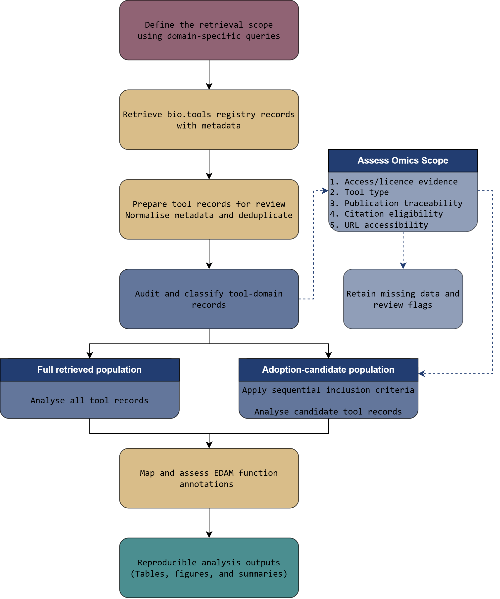

# Objective One: the omics tool landscape in bio.tools (Chapter 3)

**Objective:** programmatically investigate the omics tool landscape to assess tool availability, adoption and potential gaps, as
supporting context for tool choice and provenance.

**Research question:** How available, adopted and maintained are genomics, transcriptomics, proteomics and multi-omics tools, as
described by public registry and repository metadata? Are those metadata complete, valid and consistent enough to support
screening before installation, and where are the gaps in the tool landscape?

**Dissertation:** Chapter 3, *Beyond citations: mapping the multi-omics software ecosystem* (methods 3.2, results 3.3,
Appendix 3A). Figure 3.1 is the workflow schematic (`../00_general/04_miscellaneous/figures/objective1_methods_flowchart.png`).

## What is done

1. **Fetch** tool records for four domains from the bio.tools API (queries in Table 3.2), with publication and Dimensions
   citation enrichment and JSON manifests.
2. **Filter** each domain with topic inclusion lists and shared exclusion terms, flag metadata quality and apply the
   publication-age citation thresholds (Table 3.3) to obtain the candidate population (Table 3.4). Full retrieved populations are
   kept for comparison.
3. **Map** bio.tools `function.operation` annotations to an EDAM ontology snapshot.
4. **Analyse** the candidate population (domain overlap, registration, technical metadata, citations, GitHub commit recency and
   engagement), the EDAM curation and the full retrieved population.

Registry metadata, citations and GitHub indicators are proxies for discoverability, uptake and activity, not measures of software
quality.

---

<p align="center">
  
</p>

---

## Folder contents

| Path | Contents |
| --- | --- |
| `01a_`–`03c_*.py/R` | Analysis scripts (below) |
| `03_helpers/` | `analysis_helpers.R`, `github_helpers.R`, `landscape_plot_helpers.R`, `thesis_palette.R` (dissertation palette, also used by Objective Two), `visualize_config.yaml` (analysis date 2026-09-30, frozen GitHub cache, Dimensions citations, candidate thresholds) |
| `data/02a_data_filter_biotools/` | Topic inclusion lists per domain and `general_exclusion_terms_2026.txt` |
| `data/03a_data_tool_analysis/` | `github_commit_cache_final.csv` (frozen GitHub metadata) |
| `results/01ab_results_fetch_biotools/` | Fetched records and manifests (29 Sep 2026) |
| `results/02a_results_filter_biotools/` | Scope classifications, quality flags, candidate and full populations, filter summaries, manifests |
| `results/02bc_results_edam_annotation/` | Combined filter summary (Table 3.4), EDAM crosswalk, `edam/EDAM.owl` snapshot |
| `results/03a_results_tool_analysis/` | Candidate-population figures and statistics (`*_20261005`) |
| `results/03b_results_tool_analysis_edam/` | EDAM coverage and curation results (`*_20261005`) |
| `results/03c_results_tool_analysis_full_population/` | Full-population results (`*_20261008`) |

## Scripts

| Script | What it does | Dissertation tables/figures |
| --- | --- | --- |
| `01a_run_fetch_biotools.py` | Launcher: runs 01b once per omics domain with the domain query lists (Table 3.2) | Table 3.2 |
| `01b_fetch_biotools.py` | bio.tools API retrieval, function/publication tables and citation counts (called by 01a) | Table 3.2 |
| `02a_filter_biotools.R` | Scope classification, quality flags and candidate selection per domain (Tables 3.3, 3.4) | Table 3.3, Table 3.4, Table 4A.1, Table 5A.1 |
| `02b_combine_filter_summaries.R` | Combine the per-domain filter summaries into Table 3.4 | Table 3.4 |
| `02c_map_edam_operations.py` | Map bio.tools function.operation annotations to the EDAM ontology snapshot | Figure 3.4 |
| `03a_visualize_biotools.R` | Candidate-population analyses, statistics and figures (most Chapter 3 figures) | Table 3.5, Table 3.6, Figure 3.2, Figure 3.3, Figure 3.5, Figure 3.6, Figure 3.7, Figure 3.8, Table 3A.2, Figure 3A.1, Figure 3A.2, Figure 3A.3, Figure 3A.4, Figure 3A.8, Figure 3A.9, Figure 3A.10 |
| `03b_edam_curation_analysis.R` | EDAM coverage and curation analysis (Figure 3.4, Table 3A.1, Figure 3A.7) | Figure 3.4, Table 3A.1, Figure 3A.7 |
| `03c_visualize_age_registration_full_population.R` | Age-citation and registration analyses of the full retrieved population | Table 3.5, Table 3A.3, Figure 3A.5, Figure 3A.6 |

## Order of running

`01a` (calls `01b`) → `02a` → `02b` and `02c` → `03a` (sources `03b`) → `03c`.

## Paths

All scripts resolve their inputs and outputs from this folder: helpers and settings in `03_helpers/`, inputs in `data/` and
`results/`, outputs in the `results/NN_results_*` folders listed above. Relative paths in `03_helpers/visualize_config.yaml`
are resolved from that file's folder. The saved results do not need re-running to be inspected.

## How to run each script

Run commands from this folder. Python ≥ 3.10 with `requests`; R ≥ 4.6 (each R script checks for its packages at start-up).

### `01a_run_fetch_biotools.py`

Launcher: runs 01b once per omics domain with the domain query lists (Table 3.2).

- **Dissertation:** Sections 3.2.2–3.2.3; Table 3.2
- **Inputs:** bio.tools API (https://bio.tools/api/tool/); Dimensions citation enrichment
- **Outputs:** results/01ab_results_fetch_biotools/results_fetch_biotools_final/{domain}_fetch_biotools_sept2026.tsv (+ .functions.tsv, .publications.tsv, .manifest.json)
- **Run record:** results/01ab_results_fetch_biotools/results_fetch_biotools_final/*_fetch_biotools_sept2026.tsv.manifest.json
- **Run for the dissertation:** 2026-09-29
- **Before running:** Writes to `results/01ab_results_fetch_biotools/results_fetch_biotools_final/` by default. Re-fetching gives different numbers from the saved run.
- **Note:** The manifests record the queries, counts and output MD5s.

```bash
python 01a_run_fetch_biotools.py --output-tag sept2026   # all four domains; run 29 Sep 2026 on the server
```

### `01b_fetch_biotools.py`

bio.tools API retrieval, function/publication tables and citation counts (called by 01a).

- **Dissertation:** Sections 3.2.2–3.2.3; Table 3.2
- **Inputs:** bio.tools API
- **Outputs:** as O1-01
- **Run record:** as O1-01
- **Run for the dissertation:** 2026-09-29

```bash
python 01b_fetch_biotools.py "[comma-separated queries]" [domain]_fetch_biotools_sept2026.tsv --citation-source dimensions
```

### `02a_filter_biotools.R`

Scope classification, quality flags and candidate selection per domain (Tables 3.3, 3.4).

- **Dissertation:** Sections 3.2.4–3.2.5; Table 3.3, Table 3.4, Table 4A.1, Table 5A.1
- **Inputs:** 01ab fetch TSVs (+ .functions.tsv); data/02a_data_filter_biotools/{domain}_keep_topics.txt, general_exclusion_terms_2026.txt
- **Outputs:** results/02a_results_filter_biotools/ ({domain}_candidate_tools, _all_records_quality_flags, _all_function_operations, _filter_summary, citation/scope tables)
- **Run record:** results/02a_results_filter_biotools/{domain}_reproducibility_manifest.json
- **Run for the dissertation:** 2026-09-30
- **Before running:** Reads the fetch TSVs from `results/01ab_results_fetch_biotools/results_fetch_biotools_final/` (only the `.functions.tsv` files and manifests are saved in the repository; the main `{domain}_fetch_biotools_sept2026.tsv` tables must be re-fetched with `01a` or copied in) and writes to `inputs.filter_results_dir` in `03_helpers/visualize_config.yaml` (`results/02a_results_filter_biotools/`).
- **Note:** Manifest MD5 of the script (cfbba563…) differs from the current file; earlier map flagged the edits as needing confirmation.

```bash
Rscript 02a_filter_biotools.R --omic=all --analysis-date=2026-09-30 --input-tag=sept2026 --check-urls --config=03_helpers/visualize_config.yaml
```

### `02b_combine_filter_summaries.R`

Combine the per-domain filter summaries into Table 3.4.

- **Dissertation:** Section 3.2.4; Table 3.4
- **Inputs:** {domain}_filter_summary*.tsv
- **Outputs:** results/02bc_results_edam_annotation/combined_filter_summaries_final.{csv,tsv}
- **Run for the dissertation:** 2026-09-30
- **Before running:** Defaults: `--results-dir=results/02a_results_filter_biotools` (input) and `--output-dir=results/02bc_results_edam_annotation` (output). It reads `[omic]_filter_summary.tsv`, or the single suffixed copy (`_jan2026`) saved in the repository; run as below it reproduces the saved `combined_filter_summaries_final.csv`.

```bash
Rscript 02b_combine_filter_summaries.R
```

### `02c_map_edam_operations.py`

Map bio.tools function.operation annotations to the EDAM ontology snapshot.

- **Dissertation:** Sections 3.2.5, 3.2.7 (EDAM operation coverage); Figure 3.4
- **Inputs:** {domain}_all_function_operations.tsv; EDAM.owl (MD5 52e00fc4…)
- **Outputs:** results/02bc_results_edam_annotation/ (all_edam_operations_mapped.tsv, edam_operation_crosswalk.tsv, edam_function_validation_sample.tsv). `all_edam_operations_mapped.tsv` is not saved in the repository; run this script to create it before `03a`.
- **Run record:** results/02bc_results_edam_annotation/all_edam_operations_mapped.tsv.manifest.json
- **Run for the dissertation:** 2026-09-30

```bash
python 02c_map_edam_operations.py --input "results/02a_results_filter_biotools/*_all_function_operations.tsv" --output results/02bc_results_edam_annotation/all_edam_operations_mapped.tsv --crosswalk-output results/02bc_results_edam_annotation/edam_operation_crosswalk.tsv --edam-owl results/02bc_results_edam_annotation/edam/EDAM.owl --aggregation-depth 1
```

### `03a_visualize_biotools.R`

Candidate-population analyses, statistics and figures (most Chapter 3 figures).

- **Dissertation:** Sections 3.2.6–3.2.7; Table 3.5, Table 3.6, Figure 3.2, Figure 3.3, Figure 3.5, Figure 3.6, Figure 3.7, Figure 3.8, Table 3A.2, Figure 3A.1, Figure 3A.2, Figure 3A.3, Figure 3A.4, Figure 3A.8, Figure 3A.9, Figure 3A.10
- **Inputs:** 02a candidate and quality-flag tables; all_edam_operations_mapped.tsv; data/03a_data_tool_analysis/github_commit_cache_final.csv; 03_helpers/*.R
- **Outputs:** results/03a_results_tool_analysis/*_20261005.{png,csv}
- **Run record:** results/03a_results_tool_analysis/reproducibility_manifest_20261005.json
- **Run for the dissertation:** 2026-10-05
- **Before running:** Uses `03_helpers/visualize_config.yaml` and the helpers in `03_helpers/` by default. Needs the 02a candidate and quality-flag TSVs (`*_candidate_tools.tsv`, `*_all_records_quality_flags.tsv`; only the multi-omics candidate TSV is saved in the repository, so re-run `02a` first) and `all_edam_operations_mapped.tsv` from `02c`. Writes to `results/03a_results_tool_analysis/` and, through `03b`, to `results/03b_results_tool_analysis_edam/`. Set `GITHUB_TOKEN` only if you refresh the GitHub cache (the saved run used the frozen cache).

```bash
Rscript 03a_visualize_biotools.R   # 03_helpers/visualize_config.yaml: analysis date 2026-09-30, frozen GitHub cache
```

### `03b_edam_curation_analysis.R`

EDAM coverage and curation analysis (Figure 3.4, Table 3A.1, Figure 3A.7).

- **Dissertation:** Sections 3.2.7 (EDAM operation coverage and curation analysis); Figure 3.4, Table 3A.1, Figure 3A.7
- **Inputs:** all_edam_operations_mapped.tsv; 02a population tables
- **Outputs:** results/03b_results_tool_analysis_edam/*_20261005.{png,csv}
- **Run record:** results/03b_results_tool_analysis_edam/edam_figure_audit_20261005.csv
- **Run for the dissertation:** 2026-10-05
- **Before running:** Not run on its own: `03a_visualize_biotools.R` sources it and calls `run_edam_curation_analysis()`, writing to `results/03b_results_tool_analysis_edam/`.

```bash
Rscript 03a_visualize_biotools.R   # runs 03b as part of 03a
```

### `03c_visualize_age_registration_full_population.R`

Age-citation and registration analyses of the full retrieved population.

- **Dissertation:** Sections 3.2.7 (Comparison with the full retrieved population); Table 3.5, Table 3A.3, Figure 3A.5, Figure 3A.6
- **Inputs:** 02a {domain}_all_records_quality_flags.tsv
- **Outputs:** results/03c_results_tool_analysis_full_population/*_full_population_20261008.{png,csv}
- **Run record:** results/03c_results_tool_analysis_full_population/reproducibility_manifest_full_population_20261008.json
- **Run for the dissertation:** 2026-10-08
- **Before running:** Uses `03_helpers/visualize_config.yaml` and `03_helpers/` by default; needs the 02a `*_all_records_quality_flags.tsv` files (re-run `02a` first). Writes to `results/03c_results_tool_analysis_full_population/`.

```bash
Rscript 03c_visualize_age_registration_full_population.R
```

## Script-to-dissertation map

| Item | Caption | Script(s) | Result file(s) |
| --- | --- | --- | --- |
| Table 3.1 | Elements of the biotoolsSchema (Ison et al., 2021) | Literature review | — |
| Table 3.2 | Search terms used for bio.tools queries | `01a_run_fetch_biotools.py`, `01b_fetch_biotools.py` | results/01ab_results_fetch_biotools/results_fetch_biotools_final/*_fetch_biotools_sept2026.tsv.manifest.json (queries) |
| Table 3.3 | Filtering criteria used for the extracted bio.tools lists | `02a_filter_biotools.R` | results/02a_results_filter_biotools/{domain}_reproducibility_manifest.json; data/02a_data_filter_biotools/*_keep_topics.txt |
| Table 3.4 | Records remaining after each inclusion criterion | `02a_filter_biotools.R`, `02b_combine_filter_summaries.R` | results/02bc_results_edam_annotation/combined_filter_summaries_final.csv |
| Table 3.5 | Spearman correlation between years since publication and total citations, candidate, and full retrieved populations | `03a_visualize_biotools.R`, `03c_visualize_age_registration_full_population.R` | results/03a_results_tool_analysis/stats_age_citations_20261005.csv; results/03c_results_tool_analysis_full_population/stats_age_citations_full_population_20261008.csv |
| Table 3.6 | Publication age and citations of GitHub-observable candidate records by commit-recency status | `03a_visualize_biotools.R` | results/03a_results_tool_analysis/stats_age_by_status_20261005.csv; stats_cpy_by_status_20261005.csv; stats_kruskal/stats_dunn_20261005.csv |
| Table 3.7 | Summary of evidence for each research question | Synthesis (text) | — |
| Figure 3.1 | Overview of the Objective One workflow, from bio.tools retrieval and metadata auditing to population construction, EDAM annotation analysis, and reproducible landscape characterisation | Schematic | 00_general/04_miscellaneous/figures/objective1_methods_flowchart.png |
| Figure 3.2 | Overlap of candidate bio.tools entries between omics domains | `03a_visualize_biotools.R` | results/03a_results_tool_analysis/upset_tools_per_omic_20261005.png; upset_intersections_20261005.csv |
| Figure 3.3 | Technical metadata of candidate tools by omics domain | `03a_visualize_biotools.R` | results/03a_results_tool_analysis/technical_stack_heatmap_20261005.png/.csv |
| Figure 3.4 | EDAM Operation groups by omics domain | `02c_map_edam_operations.py`, `03b_edam_curation_analysis.R` | results/03b_results_tool_analysis_edam/edam_operation_group_representation_by_omic_20261005.png/.csv |
| Figure 3.5 | Citation visibility by years since publication | `03a_visualize_biotools.R` | results/03a_results_tool_analysis/age_vs_citations_combined_20261005.png |
| Figure 3.6 | Repository commit-recency status by omics domain | `03a_visualize_biotools.R` | results/03a_results_tool_analysis/maintenance_distribution_all_candidates_20261005.png/.csv |
| Figure 3.7 | Commit-recency status, tool age, and age-adjusted citations | `03a_visualize_biotools.R` | results/03a_results_tool_analysis/maintenance_impact_combined_20261005.png |
| Figure 3.8 | Citations per year versus GitHub engagement | `03a_visualize_biotools.R` | results/03a_results_tool_analysis/citation_visibility_vs_github_engagement_20261005.png |
| Table 3A.1 | Share of candidate records with a valid annotation in each EDAM Operation group (Wilson 95% CI) | `03b_edam_curation_analysis.R` | results/03b_results_tool_analysis_edam/edam_operation_group_representation_by_omic_20261005.csv |
| Table 3A.2 | Association between citations per year and GitHub engagement among GitHub-observable candidate records | `03a_visualize_biotools.R` | results/03a_results_tool_analysis/stats_cit_vs_engagement_20261005.csv |
| Table 3A.3 | Delay between publication and registration in bio.tools, candidate, and full retrieved populations | `03c_visualize_age_registration_full_population.R` | results/03c_results_tool_analysis_full_population/registration_delay_summary_full_population_20261008.csv |
| Figure 3A.1 | Records flagged as outliers from the age–citation trend | `03a_visualize_biotools.R` | results/03a_results_tool_analysis/outlier_inspection_20261005.png |
| Figure 3A.2 | Age–citation trend with and without flagged records displayed | `03a_visualize_biotools.R` | results/03a_results_tool_analysis/age_vs_citations_scatter_vs_clean_20261005.png |
| Figure 3A.3 | Years since publication against total citations by commit-recency status | `03a_visualize_biotools.R` | results/03a_results_tool_analysis/maintenance_age_vs_citations_faceted_20261005.png |
| Figure 3A.4 | Commit-recency status within the five most common tool types | `03a_visualize_biotools.R` | results/03a_results_tool_analysis/tool_type_status_pct_20261005.png/.csv |
| Figure 3A.5 | Citation visibility by years since publication in the full retrieved population | `03c_visualize_age_registration_full_population.R` | results/03c_results_tool_analysis_full_population/age_vs_citations_combined_full_population_20261008.png |
| Figure 3A.6 | Tool–domain records added to bio.tools per year in the full retrieved population | `03c_visualize_age_registration_full_population.R` | results/03c_results_tool_analysis_full_population/tools_added_per_year_by_omics_full_population_20261008.png; added_per_year_full_population_20261008.csv |
| Figure 3A.7 | Records without a valid EDAM Operation annotation by citation visibility | `03b_edam_curation_analysis.R` | results/03b_results_tool_analysis_edam/edam_curation_by_citation_visibility_20261005.png; edam_curation_not_valid_share_20261005.csv |
| Figure 3A.8 | Share of each year's registrations by omics domain | `03a_visualize_biotools.R` | results/03a_results_tool_analysis/tools_added_per_year_by_omics_pct_20261005.png |
| Figure 3A.9 | Publication year against year of registration in bio.tools | `03a_visualize_biotools.R` | results/03a_results_tool_analysis/publication_vs_year_added_scatter_20261005.png |
| Figure 3A.10 | Tool types by omics domain | `03a_visualize_biotools.R` | results/03a_results_tool_analysis/tool_type_distribution_by_omics_bars_20261005.png |

## Reproducibility notes

- The saved analyses use analysis date 2026-09-30, the frozen GitHub cache and Dimensions citations (`visualize_config.yaml`).
  Re-fetching bio.tools, citations or GitHub data will give different numbers.
- Each results folder has a manifest (`*.manifest.json`, `*_reproducibility_manifest*.json`) with inputs, settings and checksums.
- GitHub authentication is read from `GITHUB_TOKEN`; never commit tokens.
- Table 3A.3: the full-population columns are in `registration_delay_summary_full_population_20261008.csv`; the candidate-population
  columns are not exported to a file.

## Sources

[bio.tools](https://bio.tools/) registry; [EDAM ontology](https://edamontology.org/); Dimensions citation data; GitHub repository
metadata.
