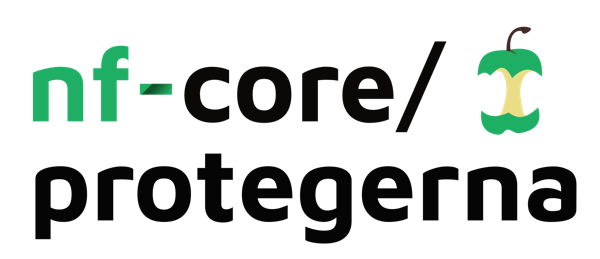

<h1>
  <picture>
    <source media="(prefers-color-scheme: dark)" srcset="docs/images/nf-core-protegerna_logo_dark.png">
    
  </picture>
</h1>

[](https://github.com/codespaces/new/nf-core/protegerna)
[](https://github.com/nf-core/protegerna/actions/workflows/nf-test.yml)
[](https://github.com/nf-core/protegerna/actions/workflows/linting.yml)[](https://nf-co.re/protegerna/results)[](https://doi.org/10.5281/zenodo.XXXXXXX)
[](https://www.nf-test.com)

[](https://www.nextflow.io/)
[](https://github.com/nf-core/tools/releases/tag/4.1.0)
[](https://docs.conda.io/en/latest/)
[](https://www.docker.com/)
[](https://sylabs.io/docs/)
[](https://cloud.seqera.io/launch?pipeline=https://github.com/nf-core/protegerna)

[](https://nfcore.slack.com/channels/protegerna)[](https://bsky.app/profile/nf-co.re)[](https://mstdn.science/@nf_core)[](https://www.youtube.com/c/nf-core)

## Introduction

**nf-core/protegerna** is a bioinformatics pipeline that ...

<!-- TODO nf-core:
   Complete this sentence with a 2-3 sentence summary of what types of data the pipeline ingests, a brief overview of the
   major pipeline sections and the types of output it produces. You're giving an overview to someone new
   to nf-core here, in 15-20 seconds. For an example, see https://github.com/nf-core/rnaseq/blob/master/README.md#introduction
-->

<!-- TODO nf-core: Include a figure that guides the user through the major workflow steps. Many nf-core
     workflows use the "tube map" design for that. See https://nf-co.re/docs/community/brand/workflow-schematics#examples for examples.   -->
<!-- TODO nf-core: Fill in short bullet-pointed list of the default steps in the pipeline -->1. Read QC ([`FastQC`](https://www.bioinformatics.babraham.ac.uk/projects/fastqc/))2. Present QC for raw reads ([`MultiQC`](http://multiqc.info/))

## Usage

> [!NOTE]
> If you are new to Nextflow and nf-core, please refer to [this page](https://nf-co.re/docs/get_started/environment_setup/overview) on how to set-up Nextflow. Make sure to [test your setup](https://nf-co.re/docs/get_started/run-your-first-pipeline) with `-profile test` before running the workflow on actual data.

Prepare a CSV samplesheet with these columns:

```csv
sample,tool,event_type,path,batch,condition
S1,fusion,FUSION,S1.FusionInspector.fusions.abridged.tsv,batch1,CASE
CASE-CTRL,rmats,SE,SE.MATS.JC.txt,batch1,CASE-CTRL
cohort,suppa,IOE,events.ioe,batch1,NA
cohort,suppa,PSI,events.psi,batch1,NA
```

The `tool` values are `fusion`, `rmats` and `suppa`. Valid event types are
`FUSION` for fusion, `SE`, `A3SS`, `A5SS`, `MXE` or `RI` for rMATS, and
`IOE` or `PSI` for SUPPA. Relative `path` values are resolved relative to
the samplesheet.

Now, you can run the pipeline using:

<!-- TODO nf-core: update the following command to include all required parameters for a minimal example -->

```bash
nextflow run nf-core/protegerna \
   -profile <docker/singularity/.../institute> \
   --input samplesheet.csv \
   --outdir <OUTDIR>
```

> [!WARNING]
> Please provide pipeline parameters via the CLI or Nextflow `-params-file` option. Custom config files including those provided by the `-c` Nextflow option can be used to provide any configuration _**except for parameters**_; see [docs](https://nf-co.re/docs/running/run-pipelines#using-parameter-files).

For more details and further functionality, please refer to the [usage documentation](https://nf-co.re/protegerna/usage) and the [parameter documentation](https://nf-co.re/protegerna/parameters).

## Pipeline output

To see the results of an example test run with a full size dataset refer to the [results](https://nf-co.re/protegerna/results) tab on the nf-core website pipeline page.
For more details about the output files and reports, please refer to the
[output documentation](https://nf-co.re/protegerna/output).

## Credits

nf-core/protegerna was originally written by Kimberly C Coetzer.

We thank the following people for their extensive assistance in the development of this pipeline:

<!-- TODO nf-core: If applicable, make list of people who have also contributed -->

## Contributions and Support

If you would like to contribute to this pipeline, please see the [contributing guidelines](docs/CONTRIBUTING.md).

For further information or help, don't hesitate to get in touch on the [Slack `#protegerna` channel](https://nfcore.slack.com/channels/protegerna) (you can join with [this invite](https://nf-co.re/join/slack)).

## Citations

<!-- TODO nf-core: Add citation for pipeline after first release. Uncomment lines below and update Zenodo doi and badge at the top of this file. -->
<!-- If you use nf-core/protegerna for your analysis, please cite it using the following doi: [10.5281/zenodo.XXXXXX](https://doi.org/10.5281/zenodo.XXXXXX) -->

<!-- TODO nf-core: Add bibliography of tools and data used in your pipeline -->

An extensive list of references for the tools used by the pipeline can be found in the [`CITATIONS.md`](CITATIONS.md) file.

You can cite the `nf-core` publication as follows:

> **The nf-core framework for community-curated bioinformatics pipelines.**
>
> Philip Ewels, Alexander Peltzer, Sven Fillinger, Harshil Patel, Johannes Alneberg, Andreas Wilm, Maxime Ulysse Garcia, Paolo Di Tommaso & Sven Nahnsen.
>
> _Nat Biotechnol._ 2020 Feb 13. doi: [10.1038/s41587-020-0439-x](https://dx.doi.org/10.1038/s41587-020-0439-x).


# nf-core/protegerna

Generate a proteogenomic protein database from FusionInspector, rMATS and SUPPA results using Nextflow DSL2 on a local Linux server with Apptainer.

```text
samplesheet + matched reference files
                   |
validate: optional GTF database creation + GENCODE concordance + peptide cache
                   |
       fusion                 splice
   fusiontoprotein     rmatstoprotein + suppatoprotein
                   |
       merge: exact amino-acid sequence deduplication
                   |
       qc: strict proteogenomic FASTA validation
```

`main.nf` invokes `workflows/protegerna.nf`, which runs the `VALIDATE` and `SPLICE` subworkflows and the fusion, merge and QC modules directly. Every process under `modules/local/protegerna/` runs one command, `python3 -B runtime/nextflow_adapter.py <stage>`, with its inputs and options passed as a JSON payload; the adapter calls the bundled reconstruction code in `assets/proteogenomic_runtime` and records provenance. The container supplies the Python dependencies.

## Profiles

The pipeline has exactly two profiles. Both use the local executor with Apptainer.

| Profile | Purpose |
| --- | --- |
| `publication` | Main production run. Every input and option is supplied in a params file. |
| `test` | Small synthetic smoke test that proves the installation works. |

Running without one of these profiles stops with a usage message.

## Run on the server

Requirements: Nextflow 25.10.4 or later, a compatible Java runtime, and Apptainer. No scheduler is used.

Build the dependency image from the repository root:

```bash
apptainer build protegerna.sif containers/proteogenomic/Apptainer.def
```

Copy `assets/params.publication.yml` to `params.yml`, set the paths, and prepare a samplesheet like `assets/samplesheet.csv` (described below). Provide exactly one of `gtf` or `gtf_db`.

```bash
nextflow run . -profile publication \
  -params-file params.yml \
  -work-dir work/protegerna \
  -resume
```

`params.publication.yml` lists every parameter the pipeline accepts: inputs, references, runtime limits and all options of the `validate`, `fusion`, `rmats`, `suppa`, `merge` and `qc` stages, pre-filled with the publication values. Edit any value. Delete a line to keep its publication value. A misspelt stage option stops the run before any task starts. The values actually used are written to `pipeline_info/resolved_stage_options.json`.

`max_cpus` and `max_memory` bound the local executor and individual tasks. The publication profile requests 2 CPUs/8 GB for medium and 4 CPUs/16 GB for high-load processes. Change these per process with `-c custom.config` if needed. Workers are capped at the CPUs allocated to their process. Use an absolute path for the SIF image. Keep the work directory and `.nextflow` cache to resume; inputs and task results are passed through channels, not discovered in published output folders.

## Samplesheet

One row describes one existing result file, not a FASTQ file. Paths may be absolute or relative to the samplesheet. Globs and directories are not accepted. Every column below is required; use `NA` for unknown batch/condition metadata.

| Column | Meaning |
| --- | --- |
| `sample` | Fusion sample ID; rMATS comparison ID such as `CASE-CTRL`; SUPPA cohort/file-set label. |
| `tool` | `fusion`, `rmats` or `suppa`. |
| `event_type` | Fusion: `FUSION`; rMATS: `SE`, `A3SS`, `A5SS`, `MXE`, `RI`; SUPPA: `IOE` or `PSI`. |
| `path` | Full path to a result file. rMATS inputs are final event tables, not `.rmats` preparation files. |
| `batch` | Batch label; explicit metadata is preserved even if the original filename is repeated in another batch. |
| `condition` | Fusion condition, rMATS comparison conditions, or the condition shared by all samples in a PSI matrix; otherwise `NA`. |

Fusion IDs must be unique across the sheet. Repeated input paths and empty files are rejected. The sheet determines which producers run; at least one producer is required. Validation, merge and QC are mandatory.

All inputs for each tool are processed together, preserving the source workflow's pooled SUPPA PSI evidence and cohort-wide reconstruction semantics. Do not include both combined and split copies of the same SUPPA observations. SUPPA requires IOE and PSI rows by default. Set `suppa_require_psi: false` only when intentionally disabling PSI-based filtering.

SUPPA sample IDs come from PSI column headers, rather than the cohort label. For mixed-condition matrices, the optional `sample_metadata` CSV/TSV supplies `sample_id,batch,condition` per sample; those values override row-level defaults. rMATS counts remain comparison-level evidence and are not assigned to individual samples.

## References and policy

Use the same genome and annotation as the upstream RNA workflows. Provide an uncompressed genome FASTA and target reference proteome, a matching GTF or gffutils database, and the official matching GENCODE protein translations FASTA (`.fa` or `.fa.gz`). An optional contaminant FASTA is added during merge.

The biological policy is the frozen publication policy in `assets/workflow.publication.v5.toml` (the configuration that built the publication database). `scripts/build_runtime.py` resolves it against the program parsers into `assets/resolved_publication_defaults.json`, the single source of stage defaults, and regenerates `assets/params.publication.yml` from it. The earlier conservative, exploratory and development reconstruction profiles no longer exist (they were also removed from the reconstruction source). Any of their settings can be applied explicitly in the params file; for example, the former exploratory behaviour is `allow_alt_start: true` and `allow_longest_orf: true` under `rmats`/`suppa` plus `include_rescue_tiers: true` under `merge`. Another example:

```yaml
rmats:
  max_fdr: 0.05
  include_failed_filter_proteins: false
suppa:
  min_psi: 0.1
```

Output options are task-local file names; `outdir` controls publication. Input lists are supplied by the samplesheet and channels. `docs/toml_parameter_mapping.tsv` lists the destination of every option in the reference TOMLs, including options replaced by native Nextflow orchestration.

The GENCODE gate retains the reference code's coverage requirements: positive and negative strands, multi-exon CDS, partial CDS and nonzero leading phase, plus the configured mismatch threshold. Reconstruction waits for that gate. The shared peptide cache is verified against sequence and digestion settings; any rebuild happens in a task-local copy.

## Outputs and provenance

The final search database is `merge/proteogenomic_database.fasta`. Merge also publishes metadata, original-to-final ID mapping, peptide evidence, biological interpretation, and summary TSV/JSON files. `fusion/`, `rmats/` and `suppa/` contain producer FASTAs and audit tables. `validate/` contains concordance results; `cache/` contains the reference peptide cache. With default names, QC tables are under `qc/qc/`.

`pipeline_info/` contains timestamped Nextflow report, timeline, trace and DAG, combined `software_versions.yml`, and a run JSON recording parameters, command line, Nextflow version and work directory. Each biological process publishes `task_inputs.json`, `command.json` and available run manifests. The former `release_report` process is not invoked; biological evidence remains in the producer and merge tables.

## Test

The `test` profile runs a bundled synthetic fixture (results in `results/test`). It exercises GTF database creation, all reference-validation strata, all three producers, exact-sequence merge and strict QC:

```bash
nextflow run . -profile test \
  --proteogenomic_container /absolute/path/protegerna.sif
```

Expected producer records: fusion **2**, rMATS **1**, SUPPA **1**; final database: **4** unique sequences. This is an integration test, not validation against a real cohort's expected database.

With the Python dependencies installed, `python tests/run_python_smoke.py` runs every stage through the task adapter without Nextflow. `python -m unittest discover -s tests -p 'test_nextflow_adapter.py'` checks adapters and option handling. The Linux acceptance test is `bash tests/run_server_smoke.sh /absolute/path/protegerna.sif`.

`assets/samplesheet.test_data.fusion.csv` points to the supplied FusionInspector test output in the sibling `test_data` directory. It still needs the real reference files. The supplied SUPPA PSI file is empty, and no final rMATS tables were found; see `docs/validation.md` before attempting a real three-producer test.

## Updating the reconstruction code

The Python reconstruction code is copied, unmodified, from the sibling `code_proteogenomic_database_v7` directory. After changing that code, run `python scripts/build_runtime.py` (Python 3.11 or later with the pinned dependencies) from the pipeline root. It copies only the modules the pipeline can reach (following imports from the stages in `assets/runtime_overlay/nextflow_adapter.py`), records their SHA-256 hashes in `assets/proteogenomic_runtime/SOURCE_MANIFEST.json`, and regenerates `assets/resolved_publication_defaults.json` and `assets/params.publication.yml`. No source file is patched.


Test run

```bash
IMAGE="$(realpath containers/proteogenomic/protegerna.sif)"

nextflow run . \
    -profile test \
    --proteogenomic_container "$IMAGE" \
    --outdir "$(realpath results)/test_conda" \
    -work-dir "$(realpath work)/test_conda"
```    


IMAGE="$(realpath containers/proteogenomic/protegerna.sif)"

nextflow run . \
    -profile test \
    --proteogenomic_container "$IMAGE" \
    --outdir "$(realpath results)/test_woohoo" \
    -work-dir "$(realpath work)/test_woohoo"


    WARN: Apptainer cache directory has not been defined -- Remote image will be stored in the path: /home/KimberlyCC/work/nf_protegerna/work/test_woohoo/singularity -- Use the environment variable NXF_APPTAINER_CACHEDIR to specify a different location

IMAGE="$(realpath containers/proteogenomic/protegerna.sif)"

nextflow run . \
    -profile publication \
    --proteogenomic_container "$IMAGE" \
    -params-file assets/params.publication.yml \
    --outdir "$(realpath results)/test_publication_woohoo" \
    -work-dir "$(realpath work)/test_publication_woohoo" \
    -resume

The multiQC process is only run to report the pipeline information, not the biological QC.