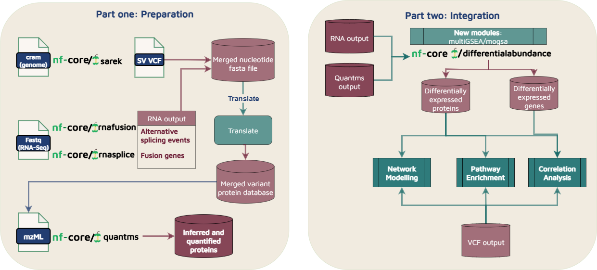

# 
protegerna

Advancing Gene Function and Disease Mechanism Insight through a Containerized Multi-Omics Integration Tool

## Abstract

The biological mechanisms of a disease can only be partially understood by a single layer of "omics”, prompting the emergence of multi-omics, a discipline that integrates diverse omics data layers to enhance the understanding of disease mechanisms. This approach allows researchers to better understand the interplay between biomolecules and their functions, bridging the gap between genotype and phenotype. Despite substantial advancements, interpreting complex integrated data remains challenging due to heterogeneity. The complexity of these extensive data analyses also poses obstacles in accurately implementing computational workflows across different environments, undermining deployment and reproducibility. Therefore, there is a need for a standardized framework that can effectively integrate and analyze multi-omics data, provide clear visualization and interpretation, and be user-friendly. In response to this, this project aims to develop a containerized tool for multi-omics integration to uncover gene function and molecular mechanisms in heritable disorders after identifying causative or contributing variants. The tool will be created and validated in Nextflow, a workflow management system that facilitates the integration of various data types. Python and R scripts will be employed in the development process to ensure robustness and accuracy. Several nf-core pipelines will be combined to prepare genomic, transcriptomic, and proteomic data for integration. These results will then be integrated using various methods for homology modelling, pathway and network analysis and functional annotation. The tool will undergo testing on a disease model using publicly available multi-omics data from Amyotrophic Lateral Sclerosis (ALS) patients, a widely prevalent neurodegenerative condition. ALS impacts the anterior horn motor neurons in the spinal cord and the pyramidal cells of the motor cortex, resulting in progressive degeneration and loss of motor function. Despite extensive investigation, the complete spectrum of genetic and molecular factors affecting its pathogenesis remains unclear. The utilization of ALS as a model seeks to deepen our understanding of neurodegenerative diseases, offering essential insights that could improve the knowledge and treatment of a wide array of genetic disorders, extending beyond neurodegenerative diseases alone. Moreover, outside this project's scope, the tool's potential use in various genetic disorders holds the promise of revealing new insights into their disease mechanisms, thus significantly contributing to the advancement of personalized treatment strategies for diverse genetic conditions.

## Contributors

Kimberly Coetzer (1)

Professor Gerard Tromp (1,2,3) (co-supervisor)

Professor Gian van der Spuy (1,2,3) (supervisor)

1. Division of Molecular Biology and Human Genetics, Department of Biomedical Sciences, Faculty of Medicine and Health Science, Stellenbosch University  

2. SAMRC Centre for Tuberculosis Research

3. Centre for Bioinformatics and Computational Biology, Faculty of Science, Stellenbosch University
