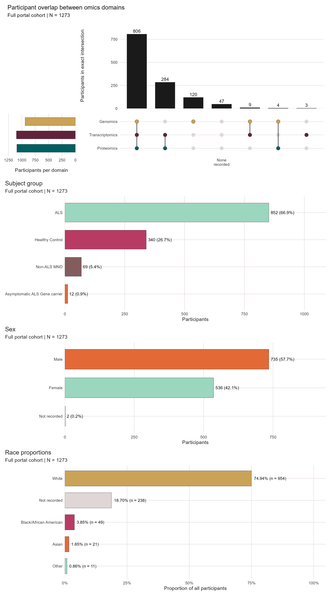
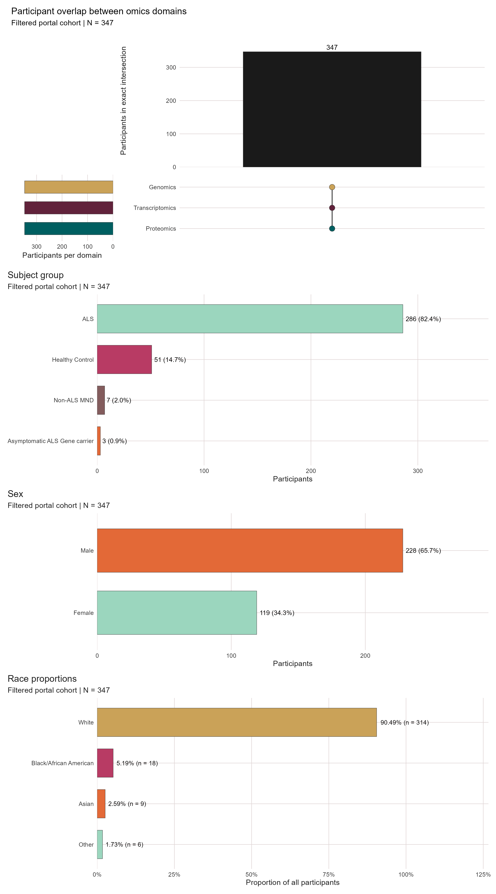

# Cohort preparation (shared by Objectives 2–4)

**Folder:** [`00_general/`](https://github.com/Kimmiecc19/protegerna/tree/main/00_general)
**Dissertation:** Section 4.2.1 and Table 4.4 (347 participants); Sections 5.2.2–5.2.4; Sections 6.2.2–6.2.4

## Overview

This step selects the matched Answer ALS cohort used by Objectives 2, 3 and 4:

1. **Filter and match participants.** Keep participants with genomic, transcriptomic and proteomic data, and remove the 52
   proteomic samples with strong batch effects. Map the remaining **347 participants** to their sample records and released
   files. Separate the recurring technical-control samples (BTC/BDC) for batching.
2. **Describe the cohort.** Summarise the cohort and variant carriers for the literature review.
3. **Review resource use.** Summarise Nextflow trace files and suggest resource settings.

Batching into six matched RNA/proteomic batches is part of Objective 3
(`03_proteogenomic_database/01_sample_batches/`).

## Cohort before participant matching and filtering

<p align="center">
  
</p>

## Installation

R ≥ 4.6 and Python 3 with `pandas`. The syntax-reference utility also needs `requests` and `beautifulsoup4`. See
[Installation](Installation).

## Inputs required

Place the Answer ALS portal tables in `00_general/01_filtering_matching_patients/data/aals_metadata_neuromine/`:

| File | Contents |
| --- | --- |
| `aals_dataportal_datatable.csv` | Participant metadata |
| `aals_released_files.csv` | Released-file paths |
| `Proteomics_Batch_Effect_Samples_52.csv` | The 52 proteomic samples to remove |
| `Sample-Mapping-File-Feb-2024.csv` | Sample-to-participant mapping |

`aals_dataportal_datatable.csv` and `Proteomics_Batch_Effect_Samples_52.csv` are already saved there. Add the other two
from the portal.

## Running

The scripts read the portal tables from `data/aals_metadata_neuromine/` and write their outputs to
`01_filtering_matching_patients/`. Run them from that folder, in this order:

```bash
cd 00_general/01_filtering_matching_patients
Rscript 01_participant_filtering.R   # -> filtered_matched_aals.csv (347 participants)
Rscript 04_aals_full_merge.R         # -> merged_aals_data.csv
Rscript 02_merged_tp_mapping.R       # -> filtered_mapping_data.csv
Rscript 03_split_bcd_btc.R           # -> samples_with_paths.csv, stratify_bdc.csv, stratify_btc.csv, stratify_bdc_ctrl.csv
```

Optional steps:

```bash
# Cohort description figures (run from the script's folder)
cd 00_general/02_demographic_plots && Rscript 01_literature_review.R && cd ../..

# Nextflow resource review (run on any pipeline's results folder)
python 00_general/03_resource_optimization/01_optimize_resources.py \
  --input-dir /path/to/nf-results --output-prefix rnasplice_

# Searchable Nextflow syntax reference (needs network access)
python 00_general/00_nf_syntax/extract_nf_syntax.py
```

## Expected outputs

| Output | Used by |
| --- | --- |
| `filtered_matched_aals.csv`: 347 matched participants | Obj. 2 (Table 4.4) |
| `merged_aals_data.csv`: metadata plus released-file paths | Table 4.4 |
| `filtered_mapping_data.csv`: sample mapping for the matched participants | `03_split_bcd_btc.R` |
| `samples_with_paths.csv`: transcriptomic and proteomic files per participant | Obj. 3 |
| `stratify_bdc.csv`, `stratify_btc.csv`, `stratify_bdc_ctrl.csv` | Obj. 3 batching (`01a_make_stratified_batches.py`) |
| `02_demographic_plots/figures_literature_review/*.pdf/png` and `*_counts.csv`: sex, ancestry, C9orf72/ATXN2 repeats, omics availability | Cohort description |
| `03_resource_optimization/results_resource_optimization/`: CPU and memory waste rankings, process summary, suggested `*_process_resource_overrides.config` for sarek, rnafusion, rnasplice and quantms | Tuning Nextflow runs |

`AALS_sample_filtering_matching.md` records the selection steps and counts at each stage.

## Before you run / known issues

- `filtered_aals_cleaned.csv` is a cleaned copy of `filtered_matched_aals.csv`. Check which one a downstream script reads.
- `04_miscellaneous/move_participants_by_batch.sh` and `unpack_dir.py` are file-management utilities (moving files into batch
  folders and flattening download folders). Their results are not reported in the dissertation. The first reads the batch
  assignments from `03_proteogenomic_database/01_sample_batches/01_results_stratified_batches/batch_files/transcriptomic_batches.csv`.
  Set `FASTQ_DIR` (and optionally `BATCH_DIR`) to the downloaded FASTQ folder before running it, because it **moves** folders.

## Cohort after participant matching and filtering

<p align="center">
  
</p>

## Notes
