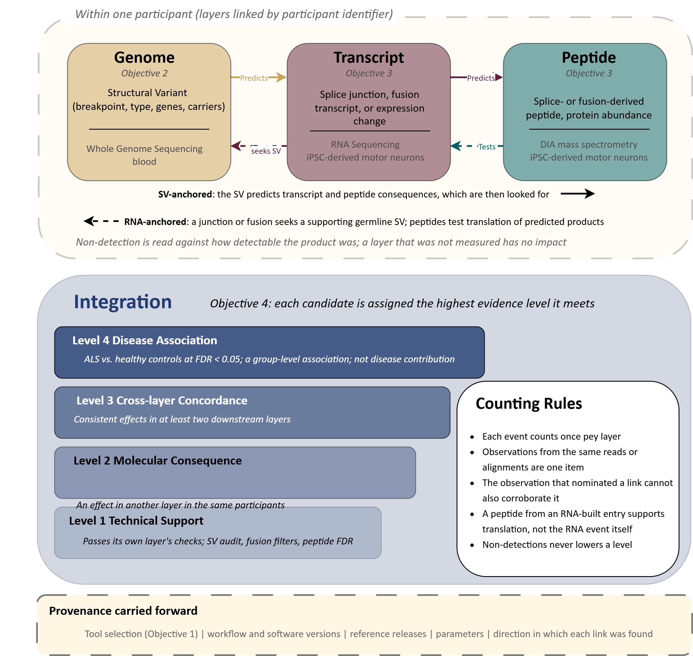

# Multi-omics integration: design logic and methodological considerations

This page explains **why** the [Objective 4](Objective-4-Multi-Omics-Integration) integration framework is built the
way it is. It covers how the layers are linked within participants, how evidence is graded, how each analysis is
calibrated so that a negative result can be read, and what the results can and cannot support. It summarises Chapter 6
of the dissertation (Sections 6.1, 6.2 and 6.4). For how to run each step, see
[Objective 4](Objective-4-Multi-Omics-Integration).

**Contents**
- [Multi-omics integration: design logic and methodological considerations](#multi-omics-integration-design-logic-and-methodological-considerations)
  - [1. What the framework is for](#1-what-the-framework-is-for)
    - [Why event-level integration rather than cohort-level methods (Section 2.6)](#why-event-level-integration-rather-than-cohort-level-methods-section-26)
  - [2. How success is judged](#2-how-success-is-judged)
  - [3. Principles for combining evidence](#3-principles-for-combining-evidence)
  - [4. Inputs and their status](#4-inputs-and-their-status)
  - [5. Cohort, linkage and quality control](#5-cohort-linkage-and-quality-control)
  - [6. Statistical principles: three kinds of threshold](#6-statistical-principles-three-kinds-of-threshold)
  - [7. Single-layer analyses](#7-single-layer-analyses)
  - [8. SV consequences: carrier scan and positive control](#8-sv-consequences-carrier-scan-and-positive-control)
  - [9. Peptide-source classification and novel-peptide review](#9-peptide-source-classification-and-novel-peptide-review)
  - [10. Linking the layers within participants](#10-linking-the-layers-within-participants)
    - [10.1 Participant-level event linking (Stages 1–3)](#101-participant-level-event-linking-stages-13)
    - [10.2 Gene- and participant-level agreement](#102-gene--and-participant-level-agreement)
    - [10.3 Fusion–peptide concordance](#103-fusionpeptide-concordance)
    - [10.4 SV–fusion containment and WGS confirmation](#104-svfusion-containment-and-wgs-confirmation)
  - [11. Evidence grading](#11-evidence-grading)
  - [12. Evaluating integration: reclassification rules](#12-evaluating-integration-reclassification-rules)
  - [13. Sensitivity analyses](#13-sensitivity-analyses)
  - [14. How to interpret the outputs](#14-how-to-interpret-the-outputs)
  - [15. Limitations, transferability and future work](#15-limitations-transferability-and-future-work)
  - [Key literature](#key-literature)

---

## 1. What the framework is for

Finding a variant, an altered splice event or a fusion transcript doesn't establish a mechanism. An SV overlapping an
ALS gene may leave the coding sequence intact, change dosage, or disturb a regulatory or splice region. An altered
transcript need not be translated into a stable protein, and a fusion transcript need not produce a fusion protein. The
framework asks whether candidate events have **measurable consequences in matched data from the same individuals**.

Answer ALS makes this possible because the genome (blood) and the RNA and proteome (iPSC-derived motor neurons) come from
the **same participants**. An RNA event can be evaluated against that person's genotype and proteome. The layers are
matched by **individual, not by biological material**, so differentiation variability and batch structure must be
considered.

| Layer | Information contributed (Table 6.1) |
| --- | --- |
| Genomics | Potential upstream structural changes |
| Transcriptomics | Gene expression and fusion transcripts (splice events only built the search database) |
| Proteomics | Detectable protein abundance and peptide-sequence evidence |
| Integrated analysis | Connections between events and downstream consequences |

**Aim:** assess whether the framework can **trace candidate events and their evidence across participant-matched layers,
in both directions, and grade that evidence under fixed rules**. Four research questions:

1. What does each layer alone show about ALS vs healthy controls? *(contextual)*
2. Do SVs, including those in ALS genes, measurably change the expression of the genes they overlap?
3. What peptide evidence does the expanded proteogenomic database contribute, and is it supported by matched RNA?
4. How does integration change the interpretation and prioritisation of candidates compared with single-layer analysis?

### Why event-level integration rather than cohort-level methods (Section 2.6)

Latent-factor and multi-block methods such as MOFA and DIABLO are valid for finding structure shared across a cohort,
and Answer ALS isn't too small for them. Three properties make them unsuited to this question:

1. **The question they answer.** Their outputs are shared variation, subgroups or predictive signatures. They don't show
   whether a particular SV produces a matching transcript consequence and discriminating peptide in its carrier. In iPSC
   data, their dominant axes can reflect sex, genetic background, differentiation batch or cell composition rather than
   disease.
2. **Data structure.** DIABLO needs every layer for every sample, and MOFA learns from co-occurring layers, whereas
   proteomic missingness is usually not at random. A **private SV and its fusion, junction or peptide products exist in
   one individual only**, so they contribute little to the shared covariation these methods model.
3. **Interpretability.** A factor or cluster combines weighted contributions from many features, but it doesn't state
   that a specific variant altered a specific transcript and produced a specific peptide, or record which observations
   support that. **For mechanism prioritisation, that traceable chain is the required output.**

The design follows instead the **sequential, variant-centric integration of rare-disease diagnostics**: the genome is
analysed first, then RNA (and increasingly protein) in the same individual is used to confirm or re-prioritise candidates
(e.g. OUTRIDER, FRASER, DROP, PROTRIDER). Precedents such as Sorrentino et al. (2026) report unpredictable relationships
between layers, so **discordance between layers is an expected outcome to represent, not noise to filter out**.

## 2. How success is judged

The framework is judged on whether integration:
- **provides matched-layer support** for a single-layer prediction;
- **rejects** single-layer findings that matched data don't support; or
- **separates** variants with a measurable molecular consequence from those without one.

It is **not** judged on producing more significant ALS findings, and ALS case–control analyses are contextual. Where one
layer is enough, or integration doesn't change a conclusion, that is reported. With no ground truth, the outcome counts
show **how integration changes the classification of candidates, not whether it makes that classification more
accurate**. Practical utility is defined as **traceability, auditability and disciplined interpretation**.

## 3. Principles for combining evidence

These design decisions apply throughout the framework:

| Principle | Reason |
| --- | --- |
| **No clinical scoring frameworks.** ACMG/AMP points weren't used | They're calibrated for clinical pathogenicity. The MacArthur et al. (2014) causality guidelines define evidence categories without points. With no ground-truth set of SV-driven mechanisms, candidates are **ordered by documented rules, not scored** |
| **Each event counts once per layer** | Evidence items aren't independent |
| **Observations from the same reads or alignments are one item** | e.g. fusion-report caller counts and IGV views of the same RNA reads document a fusion but don't corroborate a duplication |
| **A peptide from an RNA-derived database entry supports translation of the predicted product, not the RNA event** | The sequence came from the RNA call, so it can't independently confirm it |
| **An RNA junction or fusion leading back to an SV is the transcript-layer evidence for that link**, not extra corroboration | Prevents counting the same observation twice |
| **Non-detection never lowers a candidate's level** | Each layer records *not measured* vs *measured and not detected*, interpreted against detectability and power |
| **Every analysis is paired with a calibration** | So a negative result can be interpreted (see [Section 6](#6-statistical-principles-three-kinds-of-threshold)) |
| **Mechanistic plausibility is kept separate from disease association** | A group-level ALS difference neither requires nor implies a mechanism for a particular variant |

The evidence levels support claims of **mechanistic plausibility only**, not pathogenicity or disease contribution.

## 4. Inputs and their status

| Input | From | Used for | Status / caveat |
| --- | --- | --- | --- |
| 24 audited primary SV candidates (25 candidate–gene rows) and 55 participant–candidate pairs | [Objective 2](Objective-2-Structural-Variants) | Primary-candidate tests | Audited against raw calls |
| Full **unfiltered** AnnotSV event tables: intersection (31,023 events: 25,569 DEL, 5,454 DUP) and union-only (116,214) | Objective 2 | Genome-wide scan and positive control | **Not filtered on caller FILTER status**, so they include failed calls |
| **Filtered** (ALS-gene) tables: 185 intersection, 729 union-only events | Objective 2 | SVs in ALS genes; evaluation of integration | Mostly not audited |
| Search database (v5) and six DIA-NN searches | [Objective 3](Objective-3-Proteogenomic-Database) | Peptide classification, peptide links, carrier protein levels | **Superseded build**, so every peptide-level result depends on it |
| Answer ALS RNA counts, release 7 | Consortium | Expression, DE, carrier scans | |
| Answer ALS consortium protein matrix (pre-batch-corrected; OpenSWATH/MapDIA; 4,144 proteins) | Consortium | Primary protein DA and pathways | Independent of the custom database; lacks several candidate ALS genes |
| nf-core/rnafusion 4.0.0 (FusionInspector + fusion-report) | Objective 3 | Fusion filtering, recurrence and SV–fusion overlap | |
| rnasplice quantification (Salmon, SUPPA PSI, rMATS) | Objective 3 | **Not used** | Invalidated by a strandedness error (reverse-stranded libraries processed as forward-stranded) |

Gene expression, fusion calls, the SV analyses and the consortium protein matrix **don't** depend on the superseded
search database.

## 5. Cohort, linkage and quality control

- **Comparison set:** 336 participants with RNA (286 ALS, 50 healthy controls). 332 of them also have proteogenomic-search
  data. The 7 non-ALS MND and 3 asymptomatic carriers are **too few to compare** and are described individually where
  they carry a candidate. CASE vs CTRL differs from ALS vs controls by only these 10, so it isn't analysed separately.
- **Recurring control line** CTRL-NEUEU392AE8: used to monitor technical consistency and to define fusion filter F6.
  Excluded from all biological comparisons, and its repeats are never counted as independent controls.
- **Linkage:** a CASE-/CTRL-NEUxxxxxx participant ID is extracted from every sample, run and genome name and used to join
  all layers. RNA samples matched the consortium count matrix exactly. Multiple samples per participant (the control line
  only) are averaged. Proteomic runs map to participants through a cohort manifest.
- **Labels:** checked against the Answer ALS diagnosis mapping (enrolment diagnosis). One control, CTRL-NEUCV809LL4, later
  received an ALS diagnosis. It remains among the 50 controls, and an analysis excluding it wasn't run.
- **QC:**
  - **RNA.** Library sizes 12.7–73.4 M (median 30.8 M). Samples > 3 MAD below the median log10 size were flagged (three)
    but retained. PCA of the 2,000 most variable genes quantifies variance from batch, sex and diagnosis.
  - **Proteomics.** Zeros become missing, values are log2 and median-centred. **No imputation.** Proteins are tested
    only if quantified in ≥ 70% of each group.
  - **Failed runs.** Runs with < 1,000 precursors (four participants) stay in their batch's DIA-NN search but are
    excluded from all proteomic and multi-omic analyses.
- **Design constraints that limit power:** sex is imbalanced (66% of controls female, 71% of ALS male). RNA was sequenced
  in 45 batches, often with ≤ 1 control per batch, and 10 batches have no controls.

## 6. Statistical principles: three kinds of threshold

| Kind | Used for | Rule |
| --- | --- | --- |
| (i) **Group comparisons** | ALS vs control gene expression, protein abundance, pathways, fusion recurrence | Benjamini–Hochberg. **FDR < 0.05 = significant**; nominal p < 0.01 = exploratory only |
| (ii) **Empirically calibrated carrier tests** | Genome-wide SV carrier scan; carrier tests in the evaluation table | p-values calibrated against random genes, then BH-adjusted |
| (iii) **Nominal participant-level thresholds** | Stage 3 integration scan | Unadjusted per SV–gene pair; judged **only by the number of effects vs a permutation null**, never pair by pair |

**Calibrations paired with each analysis:**
- Pathways: permutation of diagnosis labels **within sequencing batch**.
- SV expression scan: a **dosage positive control** (large deletions down, large duplications up).
- Stage 3: permutation of **carrier labels** across participants. This is unstratified, so it's a sensitivity check, not
  covariate-adjusted inference.

**Power** (two-group, normal approximation, 286 vs 50, 80% power): the smallest detectable difference is ~0.63 SD at
α = 0.001 and ~0.86 SD at Bonferroni for 25,368 genes. A BH threshold falls in this range when few genes are significant.

## 7. Single-layer analyses

Each layer is first analysed **on its own** to give a baseline that integration can be compared against.

- **RNA differential expression.** Genes with ≥ 10 counts in ≥ 20 samples, TMM normalisation (edgeR), then **dream**
  (variancePartition): `~ diagnosis + sex + (1 | sequencing batch)` with `voomWithDreamWeights`. The random batch effect
  suits 45 unevenly populated batches. A fixed-batch model is the sensitivity analysis.
- **Protein differential abundance.** Primary: the **consortium matrix**, limma `~ diagnosis + sex + preparation batch`
  (trend + robust eBayes, no imputation). Sensitivity: the proteogenomic DIA-NN searches (log2 MaxLFQ,
  `~ diagnosis + sex + search batch`). These quantify more protein groups (6,707–6,876 per batch), including candidate
  ALS genes (e.g. EPHA4, UNC13A, NEK1, CNTN6), so they supply carrier protein levels.
- **Pathways.** fgsea on genes ranked by moderated t, with MSigDB v2026.1 grouped as **broad**, **disease** (13
  neurodegeneration/ALS sets) and **targeted** (29 sets: splicing, RNA binding/decay, translation, NMD, proteasome,
  autophagy, stress granules, UPR, metabolism, TNF/NF-κB). Each category is tested separately, with gene sets of 15–300
  genes. **Gene-set permutation overstates significance when genes are correlated**, so the 15 smallest-p sets per layer
  are retested by permuting diagnosis **within sequencing batch** 1,000 times and refitting. A pathway is robust only if
  its empirical FDR < 0.05. Repeated with a 500-gene upper limit.
- **Fusions.** Calls are kept only if they pass all six filters (Table 6.5):

  | Filter | Criterion | Why |
  | --- | --- | --- |
  | F1 | ≥ 2 junction-spanning reads | Avoid single-read artefacts |
  | F2 | ≥ 0.1 fusion fragments per million | Minimum expression |
  | F3 | Large anchor support on both sides | Reliable breakpoint |
  | F4 | Partners are not neighbouring genes | Excludes readthrough transcripts |
  | F5 | No artefact or normal-tissue annotation (GTEx, BodyMap, Babiceanu_Normal, Greger_Normal, DGD_PARALOGS, HGNC_GENEFAM, ConjoinG, Normal) | Excludes known benign or artefactual fusions |
  | F6 | Not observed in the recurring control line | A fusion in a healthy line isn't disease-specific |

  Recurrence is tested with Fisher's exact test (pairs and partner genes with ≥ 3 carriers) plus BH. A "≥ 2 discovery
  callers" tier is the sensitivity analysis. Arriba's partner vs inferred transcript strand is a QC of the calls.
- **Splicing:** **not analysed** (see [Section 4](#4-inputs-and-their-status)). Splice events enter only as database
  entries and through peptide links.

## 8. SV consequences: carrier scan and positive control

**Genome-wide carrier scan** (unfiltered tables, covariate-aware):
- Expression is log2(CPM + 1) for 13,588 protein-coding genes with mean ≥ 1 CPM. Each gene is **adjusted for batch, sex
  and diagnosis** by linear regression, and residuals are standardised to z.
- For each event–gene pair with k carriers, the statistic is **mean carrier z × √k**. Events carried by > 50% of
  participants aren't tested.
- **Empirical null:** each carrier set is scored on **20 random expressed genes** per pair, and the nulls are pooled within
  a table. This **preserves each event's carrier structure** (including carriers shared between overlapping events) but
  not correlation between neighbouring genes. Resolution is set by the null's size: ~1.9 × 10⁵ null scores for 9,734
  intersection pairs gives a smallest p of ~5 × 10⁻⁶.
- FDR within each table, and separately within ALSoD genes.

**Positive control (why a negative result is interpretable).** Large deletions should lower, and large duplications
raise, the expression of the genes they overlap. The fraction of pairs changing in the expected direction is tested with
a **sign test within length bins** (< 1 kb, 1–10 kb, 10–100 kb, > 100 kb). If the scan detects dosage effects where they're
expected, its failure to detect effects for small, rare ALS-gene SVs means "no measurable consequence with this design",
not "the scan is blind".

**Primary candidates:** carriers vs non-carriers for RNA and (where measured) protein of the candidate gene, with robust
z-scores and Mann–Whitney. Protein comes from the proteogenomic search because the consortium matrix lacks many candidate
genes.

## 9. Peptide-source classification and novel-peptide review

**Classification.** Each identified precursor (1% run and global precursor FDR, 1% global protein-group FDR; no run-level
PG q filter) is mapped to the source records of its protein entries:
- **Reference-explained:** any reference or contaminant entry contains it.
- **Variant-only:** only custom entries contain it. These are then checked (I = L) against UniProt canonical and isoform
  sequences and GENCODE v46 translations, and classed as a **known UniProt isoform**, **GENCODE-annotated but absent from
  UniProt**, or a **novel candidate** (absent from both).

Peptides explained only by custom entries couldn't have been assigned against the canonical reference component, so they
**directly measure the custom database's contribution**.

**Reproducibility** comes in two kinds:
- **Within-batch:** the fraction of participant runs in a batch with the peptide. *Reproducibly detected* = in ≥ 50% of
  runs of at least one batch.
- **Across-batch:** how many of the six independently searched batches contain it. Because batches hold different
  participants, this mixes technical reproducibility with who carries the product.

Detection, however reproducible, supports a **peptide sequence**, not the transcript or splice event that produced it.

**Score-based spectral review** of novel candidates (`04b_review_novel_peptides.py`). Known and novel peptides may need
separate error control, and whole-search FDR doesn't provide it. Five kinds of DIA-NN evidence are summarised: CScore,
spectrum similarity, fragment co-elution (fragments with r ≥ 0.7 and median correlation), observed − predicted retention
time, and apex-RT spread across runs. These are compared with **reference identifications matched for batch, length (±3)
and intensity (±0.5 log10)**, drawn as a systematic 1-in-150 sample (RT spread is compared with known-isoform peptides).
A dimension is flagged if the candidate is in the worst 10%, and a candidate **fails with ≥ 2 flags**. This tests whether
matches look like correct identifications. It **can't establish the sequence**, which needs fragment-ion chromatograms or
synthetic peptides.

## 10. Linking the layers within participants

Integration links layers in three ways, in **both directions** (from peptides and RNA events back to SVs, and from SVs
forward to RNA and protein). Code: `02_participant_linking/00_run_linking_pipeline.py` (stages 1–5) and `03_cross_layer/`.

### 10.1 Participant-level event linking (Stages 1–3)
| Stage | What it links | Script |
| --- | --- | --- |
| 1 | Each peptide → the annotated event of its database entry, plus that gene's expression in the same participant | `01_link_peptides_to_events.py` |
| 2 | SVs → isoform events (within **5 kb**) and fusion breakpoints (within **100 kb**) in the same carrier, plus expression | `02_extract_sv_carriers.py`, `03_link_svs_to_events.py` |
| 3 | Every **rare SV** (≤ 17 carriers) vs each gene it overlaps or lies within 5 kb of, carriers vs all others | `04_test_rare_sv_rna_protein.py` |
| null | Carrier labels reassigned at random **600 times** (keeping each SV's carrier count) | `05_permutation_null.py` |

**Stage 3 effect rule:** |log2 FC of medians| ≥ 0.5 **and** (single carrier |robust z| ≥ 2.5, or several carriers
Mann–Whitney p < 0.05). RNA is unadjusted log2(CPM + 1) for genes with median ≥ 1 CPM. Protein is tested where quantified
in ≥ 50% of participants. **Tier A** = effect in both layers, **tier B** = either.

Why these numbers (set by convention, not calibrated):
- |z| 2.5 ≈ 1% of a normal distribution (two-sided).
- log2 FC 0.5 ≈ 1.4-fold.
- 17 carriers = 5% of 347 genomes.
- 5 kb = the gene-proximity window.
- 100 kb = the upper SV size limit.

**Why Stage 3 is exploratory only:** thresholds are nominal and unadjusted, SV–gene pairs share carriers and genes
(non-independence), and the permutation doesn't preserve batch, sex, diagnosis or linkage between overlapping SVs. With
600 permutations the smallest p is 1/601 ≈ 0.0017. A covariate-aware version (permuting within batch and sex strata, on
adjusted residuals) wasn't performed. **Results are a count of effects vs the null, never interpreted pair by pair.**
Proximity links rest on distance and are **not evidence of mechanism**.

### 10.2 Gene- and participant-level agreement
A **gene evidence matrix** records for every gene which layers show evidence: a prioritised SV, an RNA or protein
difference (significant or exploratory), a filtered fusion, an isoform or novel peptide, and the ALSoD category. Layer
overlaps, RNA–protein fold-change concordance and carrier RNA/protein levels come from it
(`03_cross_layer/01_cross_omics_agreement.py`).

### 10.3 Fusion–peptide concordance
For each fusion-derived variant-only peptide, the participants in whom the **peptide** is detected are compared with
those in whom the **RNA fusion** was called. If the peptide comes from the fusion, the fusion should be more frequent
among peptide-positive participants than in the cohort.

### 10.4 SV–fusion containment and WGS confirmation
- **Stricter than proximity:** a filtered fusion counts only if **both breakpoints lie inside a rare SV in the same
  participant** (`04_sv_fusion_overlap.py`). The chance expectation assigns each filtered fusion to a random participant
  (Poisson), checked with 1,000 label permutations. It assumes every participant is equally likely to carry any fusion,
  regardless of RNA depth or number of rare duplications, so it's an **exploratory expectation, not a calibrated
  probability**. Co-occurrences are consistent with, but don't confirm, an SV-caused fusion.
- **WGS check of the six duplications containing a fusion** (`03_check_duplications_in_wgs.py`, pysam, MAPQ ≥ 20,
  primary non-duplicate reads):
  - **Depth ratio:** reads starting inside vs two flanking windows (≤ 50 kb, 1 kb from each breakpoint). One extra copy
    gives ≈ 1.5.
  - **Tandem orientation:** outward-facing read pairs within 1 kb of each end, and split reads joining the two ends.
  - **Control:** outward-facing pairs between windows with the same spacing, shifted downstream by 2 × length + 5 kb.

  This is evidence **independent of the RNA reads** that defined the fusions.

## 11. Evidence grading

Evidence is recorded on **separate dimensions**, not one scale (Table 6.6):

| Dimension / level | Requirement |
| --- | --- |
| **1. Technical** | The SV passes the Objective 2 audit, the fusion passes F1–F6, or the peptide passes FDR control (a peptide failing the spectral review is rejected) |
| **2. Molecular consequence** | A measurable effect or compatible observation in **one other layer of the same participants**: an RNA or protein change in SV carriers, expression of the gene in peptide-positive participants, or the RNA fusion in peptide-positive participants |
| **3. Cross-layer concordance** | Consistent effects in **at least two downstream layers** (e.g. a deletion with lower RNA *and* lower protein) |
| *Separate:* **disease association** | ALS vs control difference at FDR < 0.05. Recorded alongside, **not a higher level** |
| *Separate:* **ALS relevance** | ALSoD category. Descriptive; **doesn't raise a level** |

Each level requires the one before it. The ordering reflects only **how many layers in the same participants agree with
the predicted mechanism**. Disease association isn't placed above mechanism, because a group-level association neither
requires nor implies a mechanism for a given variant, and concordant participant-level data aren't weaker than an
ALS-associated signal. The output is an **ordered evidence classification under fixed rules, not a calibrated ranking**
(`03_cross_layer/02_evaluation_table.py`).

## 12. Evaluating integration: reclassification rules

For each candidate (primary SVs, SVs in ALS genes, novel peptides, recurrent fusions), the **single-layer conclusion** is
set by the layer that nominated it: a prioritised variant (Objective 2), a detected peptide (DIA-NN 1% FDR) or a
recurrent fusion call. The **integrated conclusion** is assigned by fixed rules (Table 6.7), and each change is classed as
**supported, rejected, reclassified or unchanged**:

| Outcome | Rule |
| --- | --- |
| **Supported** (known-isoform peptide) | Reproducibly detected, and its gene expressed (≥ 1 CPM) in ≥ 90% of the participants in whom it was detected. This is protein-level sequence support for a predicted product, **not** confirmation of the participant's splice event |
| **Rejected** (fusion-derived novel peptide) | The fusion isn't called more often in peptide-positive than peptide-negative participants of the same batches |
| **Reclassified** (SV) | "No measurable molecular consequence": carriers show no RNA or protein effect at the carrier-scan thresholds |
| **Unchanged** (SV) | Gene not expressed, or only exploratory nominal effects |
| **Unchanged** (everything else) | No rule applies |

Classes are reported per candidate category because they measure different things. The rules make counts reproducible
from the result tables, but they were defined in this chapter and aren't validated against an independent reference. The
carrier-scan and reclassification thresholds were set by convention and **not varied**.

## 13. Sensitivity analyses

These test whether the leading **single-layer** conclusions depend on analysis choices:
- random vs fixed sequencing batch in the expression model;
- the ≥ 2-caller tier for fusions;
- intersection vs union-only SV table, and FDR across all genes vs within ALSoD genes;
- consortium vs proteogenomic-search protein quantification (DA only);
- gene-set vs label permutation for pathway significance;
- 300 vs 500 as the upper gene-set size.

## 14. How to interpret the outputs

**Principal findings (Section 6.4):**
1. **No single layer distinguished ALS from controls** at the level of individual genes, proteins or fusions. RNA-processing
   and mitochondrial pathways looked enriched but fell just short after within-batch label permutation, so they're
   reported as **borderline**.
2. **The expanded database recovered a small, reproducible set of isoform peptides**, almost all from annotated UniProt
   isoforms. 487 of 639 known-isoform peptides were reproducibly detected with their gene expressed in the same
   participants. **None of the ten apparently novel peptides was confirmed**: the five fusion-derived ones weren't
   supported by their predicted RNA fusions, and the most frequent was almost entirely a histone H2B sequence.
3. **SVs changed the expression of genes they overlap only when large.** The small, rare SVs prioritised in ALS genes
   showed no detectable effect (none of the 24 primary candidates or 798 testable ALS-gene SV–gene pairs at FDR < 0.05).
4. **Integration changed the rule-based classification of most candidates** (e.g. 747 of 776 SVs in ALS genes, 487 of 639
   isoform peptides), mostly by reclassifying SVs as having no measurable RNA consequence. **No candidate reached
   cross-layer concordance (level 3), and none showed a disease association.**
5. **Six private tandem duplications co-occurred with private fusion transcripts** in the same carriers, far more often
   than chance (0.018 expected). All six were confirmed in WGS by depth and outward-facing pairs. In the three ALS carriers
   a contained gene was also overexpressed.

**How to read them:**
- **A negative result is "not measurable with this design", not "benign".** Most ALS-gene SVs were < 1 kb with 1–2
  carriers, a range where the positive control shows little directional effect. A mechanistic claim would need evidence
  this design can't provide, such as splicing-level effects or other cell types or stages.
- **Matched RNA caught what whole-search FDR didn't.** Target–decoy control didn't flag the unsupported novel peptides,
  but checking each against the same participants' RNA did. This is the strongest argument for separate error control of
  novel peptides.
- **Isoform peptide support is sequence-level.** It shows annotated alternative isoforms are present in these neurons, not
  that a participant's detected splice event produced them.
- **The duplication–fusion cases are methodological, not disease findings.** They show the framework can identify and
  trace a candidate DNA-to-RNA relationship. Two (VPS53–GLOD4, PLEC–PARP10) join one gene's 5′ end to its neighbour, whose
  expression rose, consistent with promoter capture. Control carriers had equally supported fusions without expression
  change, so a fusion doesn't by itself imply dosage change. No junction peptide was detected, and PCR or long-read
  sequencing across the junction is the definitive test. None involves an ALS gene, and they occurred equally in ALS and
  controls.
- **Absent case–control differences reflect the cohort as much as biology.** Diagnosis explained < 3% (RNA) and < 1%
  (protein) of leading-PC variance, while batch explained up to 35% and 87%. Add 50 controls (often one per batch), sex
  imbalance, and iPSC neurons reset to an embryonic-like state. "No difference detected in this cohort, model and design",
  not "none exists".

## 15. Limitations, transferability and future work

**Limitations**
- **No splicing integration.** The strandedness error removed differential splicing, the layer most directly tied to ALS
  RNA-processing biology, so cryptic-exon and other splicing consequences of the SVs couldn't be tested.
- **SVs > 100 kb were excluded upstream**, removing the class most likely to have strong dosage effects.
- **Peptide results depend on the superseded v5 database.** The five rMATS-derived novel peptides passed only the
  score-based review and were each seen in one of six batches, more consistent with marginal matches than with
  reproducibly translated products.
- Stage 3 and the SV–fusion null are exploratory, with unstratified nulls. Seeds for the Stage 3 and fusion label
  permutations weren't saved, so those reproduce only up to Monte Carlo variation.
- Thresholds were set by convention and not varied. The reclassification rules aren't externally validated.
- Labels weren't reconciled with follow-up diagnoses (CTRL-NEUCV809LL4).
- **Component status:** the integration is a documented set of task-specific scripts with recorded inputs, checksums and
  versions, **not a packaged pipeline**, and hasn't been run end to end as one workflow. The exact commit used wasn't
  recorded with the outputs.

**Transferability.** These design elements are meant to transfer to other disorders:
- event-anchored linking in both directions;
- carrier-vs-non-carrier tests calibrated by a positive control;
- explicit evidence states per layer;
- rules that keep mechanistic plausibility separate from disease association.

A new application would need its own disease-gene resource, population references for rarity, event types and size
range, and enough cohort size for the carrier comparisons and nulls. It hasn't been tested beyond ALS.

**Future work**

Stated in Chapter 6:
1. Test the SUPPA and rMATS outputs in carriers of the primary and ALS-gene SVs, and for the events linked to isoform
   peptides. This is the most direct extension, and it needs splicing re-quantified with the correct strandedness.
2. Confirm the duplication–fusion junctions directly by PCR or long-read sequencing across the junction.
3. Confirm novel peptide sequences by fragment-ion chromatogram inspection or synthetic peptides.

Following from the stated limitations (see also dissertation Sections 7.5–7.6):

4. A covariate-aware Stage 3 (carrier labels permuted within sequencing-batch and sex strata, RNA tested on adjusted
   residuals), which the chapter notes was not performed.
5. A sensitivity analysis excluding CTRL-NEUCV809LL4, and case–control analyses with reconciled follow-up diagnoses.
6. Running the integration end to end as a single packaged workflow.

## Key literature

The published work behind this design, and what each work justifies, is listed in
[Literature and method justification](Literature-and-Method-Justification#objective-4-multi-omics-integration).
