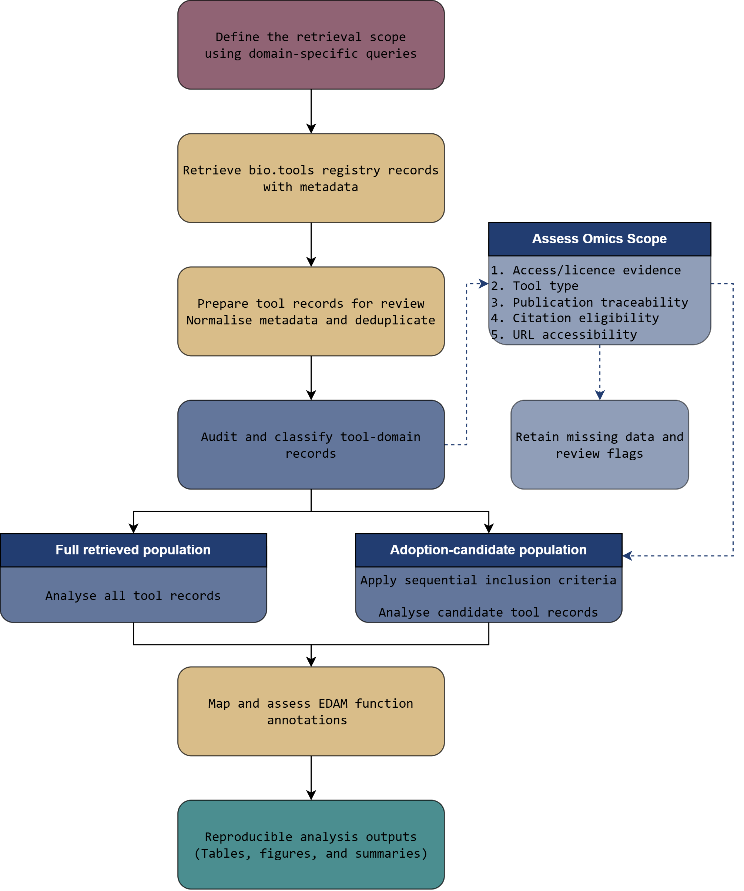

# Objective 1: The omics tool landscape in bio.tools

**Folder:** [`01_biotools_landscape/`](https://github.com/Kimmiecc19/protegerna/tree/main/01_biotools_landscape)
**Dissertation:** Chapter 3, *Beyond citations: mapping the multi-omics software ecosystem* (methods 3.2, results 3.3,
Appendix 3A)

## Overview

**Objective:** programmatically investigate the omics tool landscape to assess tool availability, adoption and potential gaps.
This gives context and provenance for the tools chosen in Objectives 2–4.

**Research question:** How available, adopted and maintained are genomics, transcriptomics, proteomics and multi-omics tools,
as described by public registry and repository metadata? Are those metadata complete, valid and consistent enough to support
screening tools before installing them? Where are the gaps in the tool landscape?



1. **Fetch** tool records for four domains from the bio.tools API (queries in Table 3.2), with publication and Dimensions
   citation enrichment.
2. **Filter** each domain with topic inclusion lists and shared exclusion terms, flag metadata quality, and apply
   publication-age citation thresholds (Table 3.3). This gives the candidate population (Table 3.4).
3. **Map** bio.tools `function.operation` annotations to an EDAM ontology snapshot.
4. **Analyse** the candidate population (domain overlap, registration, technical metadata, citations, GitHub commit recency
   and engagement), the EDAM curation and the full retrieved population.

> Registry metadata, citations and GitHub indicators are proxies for discoverability, uptake and activity. They are not
> measures of software quality.

## Installation

| Requirement | Version |
| --- | --- |
| Python | ≥ 3.10 with `requests` |
| R | ≥ 4.6. Each R script checks for its packages at start-up and reports what is missing. |
| Network access | bio.tools API, Dimensions, GitHub (only if you refresh the cache) |
| `GITHUB_TOKEN` | Optional. Needed only to refresh the frozen GitHub cache. |

No controlled-access data are needed.

## Inputs required

| Input | Location | Notes |
| --- | --- | --- |
| bio.tools API | https://bio.tools/api/tool/ | Queried live by `01a`/`01b` |
| Domain query lists (Table 3.2) | Inside `01a_run_fetch_biotools.py` | |
| Topic inclusion lists | `data/02a_data_filter_biotools/{genomic,transcriptomics,proteomic,multiomics}_keep_topics.txt` | |
| Shared exclusion terms | `data/02a_data_filter_biotools/general_exclusion_terms_2026.txt` | |
| EDAM ontology snapshot | `results/02bc_results_edam_annotation/edam/EDAM.owl` | MD5 52e00fc4… |
| Frozen GitHub metadata | `data/03a_data_tool_analysis/github_commit_cache_final.csv` | Used for the saved run |
| Analysis configuration | `03_helpers/visualize_config.yaml` | Analysis date 2026-09-30, frozen GitHub cache, Dimensions citations, candidate thresholds |
| Helper scripts | `03_helpers/analysis_helpers.R`, `github_helpers.R`, `landscape_plot_helpers.R`, `thesis_palette.R` | |

## Running

Run commands from `01_biotools_landscape/`. Order: `01a` (calls `01b`) → `02a` → `02b` and `02c` → `03a` (sources `03b`) → `03c`.

Every script finds its helpers, settings and inputs from its own location. Settings are in
`03_helpers/visualize_config.yaml`, and its relative paths are resolved from that file's folder. Outputs go to the
`results/NN_results_*` folders listed under [Expected outputs](#expected-outputs).

### Step 1: Fetch bio.tools records (Table 3.2)

```bash
python 01a_run_fetch_biotools.py --output-tag sept2026
# -> results/01ab_results_fetch_biotools/results_fetch_biotools_final/
```

`01a` runs `01b_fetch_biotools.py` once per domain. To run a single domain by hand:

```bash
python 01b_fetch_biotools.py "[comma-separated queries]" [domain]_fetch_biotools_sept2026.tsv --citation-source dimensions
```

### Step 2a: Filter and flag quality (Tables 3.3, 3.4)

```bash
Rscript 02a_filter_biotools.R --omic=all --analysis-date=2026-09-30 --input-tag=sept2026 --check-urls
```

### Step 2b: Combine filter summaries (Table 3.4)

```bash
Rscript 02b_combine_filter_summaries.R
# reads results/02a_results_filter_biotools/, writes results/02bc_results_edam_annotation/combined_filter_summaries_final.{csv,tsv}
```

Run on the saved summaries, this reproduces the saved Table 3.4 exactly.

### Step 2c: Map EDAM operations (Figure 3.4)

```bash
python 02c_map_edam_operations.py \
  --input "results/02a_results_filter_biotools/*_all_function_operations.tsv" \
  --output results/02bc_results_edam_annotation/all_edam_operations_mapped.tsv \
  --crosswalk-output results/02bc_results_edam_annotation/edam_operation_crosswalk.tsv \
  --edam-owl results/02bc_results_edam_annotation/edam/EDAM.owl \
  --aggregation-depth 1
```

### Step 3a: Candidate-population analysis (most Chapter 3 figures)

```bash
Rscript 03a_visualize_biotools.R
```

This also runs the EDAM curation analysis: `03a` sources `03b_edam_curation_analysis.R` and calls
`run_edam_curation_analysis()`, which writes to `results/03b_results_tool_analysis_edam/`. You don't run `03b` on its own.

### Step 3c: Full retrieved population

```bash
Rscript 03c_visualize_age_registration_full_population.R
```

## Expected outputs

| Step | Output folder | Key files | Run record |
| --- | --- | --- | --- |
| 01 | `results/01ab_results_fetch_biotools/results_fetch_biotools_final/` | `{domain}_fetch_biotools_sept2026.tsv` (+ `.functions.tsv`, `.publications.tsv`) | `*.manifest.json` (queries, counts, output MD5s) |
| 02a | `results/02a_results_filter_biotools/` | `{domain}_candidate_tools`, `_all_records_quality_flags`, `_all_function_operations`, `_filter_summary`, citation and scope tables | `{domain}_reproducibility_manifest.json` |
| 02b | `results/02bc_results_edam_annotation/` | `combined_filter_summaries_final.{csv,tsv}` (Table 3.4) | – |
| 02c | `results/02bc_results_edam_annotation/` | `edam_operation_crosswalk.tsv`, `edam_function_validation_sample.tsv` | `all_edam_operations_mapped.tsv.manifest.json` |
| 03a | `results/03a_results_tool_analysis/` | `*_20261005.{png,csv}`: UpSet overlap, technical-stack heatmap, age vs citations, commit-recency, GitHub engagement, statistics (Kruskal–Wallis, Dunn) | `reproducibility_manifest_20261005.json` |
| 03b | `results/03b_results_tool_analysis_edam/` | EDAM operation-group representation and curation (`*_20261005`) | `edam_figure_audit_20261005.csv` |
| 03c | `results/03c_results_tool_analysis_full_population/` | `*_full_population_20261008.{png,csv}` | `reproducibility_manifest_full_population_20261008.json` |

All saved results can be inspected without re-running.

## Before you run / known issues

Paths need no editing. Some **saved files are missing** from the repository, though, so not every step can be re-run
from the saved results alone:

| Step | Missing input | What to do |
| --- | --- | --- |
| `02a` | The main fetch tables `{domain}_fetch_biotools_sept2026.tsv` (only `.functions.tsv` and manifests are saved) | Re-fetch with `01a`, or copy the tables into `results/01ab_results_fetch_biotools/results_fetch_biotools_final/` |
| `03a`, `03c` | `*_candidate_tools.tsv` (only the multi-omics one is saved; the others exist as `.rds`) and `*_all_records_quality_flags.tsv` | Re-run `02a` first |
| `03a` | `all_edam_operations_mapped.tsv` | Run `02c` first |

`02b` accepts the saved `*_filter_summary_jan2026.tsv` copies as well as the `*_filter_summary.tsv` names that `02a` writes.

**Reproducibility:** re-fetching bio.tools, citations or GitHub data will give different numbers. To reproduce the dissertation,
use the saved fetch results, analysis date 2026-09-30 and the frozen GitHub cache.

## Dissertation map

| Item | Script | Result file |
| --- | --- | --- |
| Table 3.2 | `01a`, `01b` | `results/01ab_.../*.manifest.json` (queries) |
| Table 3.3 | `02a` | `{domain}_reproducibility_manifest.json`; `*_keep_topics.txt` |
| Table 3.4 | `02a`, `02b` | `combined_filter_summaries_final.csv` |
| Table 3.5 | `03a`, `03c` | `stats_age_citations_20261005.csv`; `stats_age_citations_full_population_20261008.csv` |
| Table 3.6 | `03a` | `stats_age_by_status`, `stats_cpy_by_status`, `stats_kruskal`, `stats_dunn` (`_20261005.csv`) |
| Figure 3.1 | Schematic | `00_general/04_miscellaneous/figures/objective1_methods_flowchart.png` |
| Figure 3.2 | `03a` | `upset_tools_per_omic_20261005.png` |
| Figure 3.3 | `03a` | `technical_stack_heatmap_20261005.png` |
| Figure 3.4 | `02c`, `03b` | `edam_operation_group_representation_by_omic_20261005.png` |
| Figure 3.5 | `03a` | `age_vs_citations_combined_20261005.png` |
| Figure 3.6 | `03a` | `maintenance_distribution_all_candidates_20261005.png` |
| Figure 3.7 | `03a` | `maintenance_impact_combined_20261005.png` |
| Figure 3.8 | `03a` | `citation_visibility_vs_github_engagement_20261005.png` |
| Tables 3A.1–3A.3, Figures 3A.1–3A.10 | `03a`, `03b`, `03c` | See the [folder README](https://github.com/Kimmiecc19/protegerna/blob/main/01_biotools_landscape/README.md#script-to-dissertation-map) |

Tables 4A.1 and 5A.1 (tools used in Objectives 2 and 3 and their outcome in this screen) also come from `02a`.

## Sources

[bio.tools](https://bio.tools/) registry · [EDAM ontology](https://edamontology.org/) · Dimensions citation data · GitHub
repository metadata

## Key literature

The published work behind this method, and what each work justifies, is listed in
[Literature and method justification](Literature-and-Method-Justification#objective-1-biotools-landscape).
