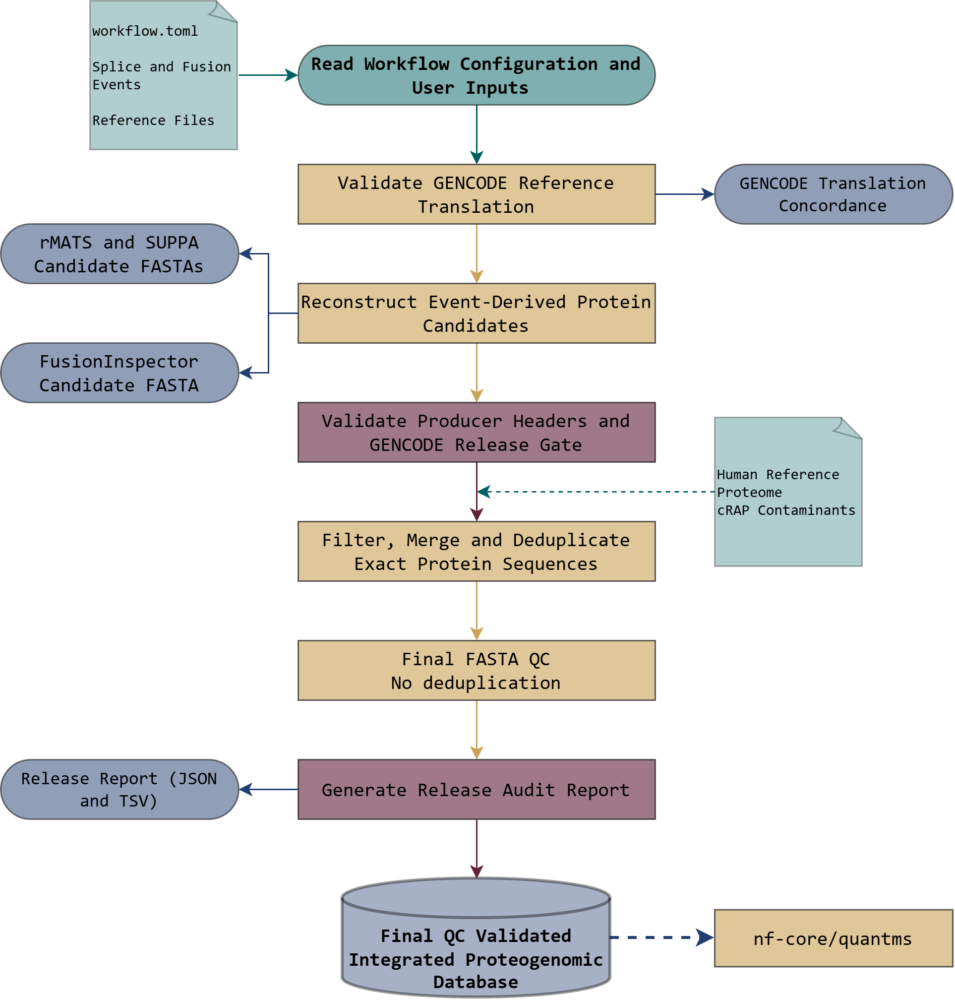

# Objective 3: Proteogenomic search database for DIA proteomics

**Folder:** [`03_proteogenomic_database/`](https://github.com/Kimmiecc19/protegerna/tree/main/03_proteogenomic_database)
(Nextflow version: [nf_protegerna pipeline](nf_protegerna-Pipeline))
**Dissertation:** Chapter 5, *Beyond the reference proteome: translating RNA events into protein hypotheses* (methods 5.2,
results 5.3, Appendix 5A)

## Overview



**Objective:** develop a proteogenomic workflow that translates gene-fusion and alternative-splicing events into a searchable
protein database for peptide identification and protein inference.

**Research question:** Can splice junctions and fusion transcripts detected from RNA-seq be translated into sample-specific
databases that identify junction and fusion peptides in matched DIA proteomes, with novel identifications controlled
separately from canonical ones? What protein-level conclusions can those peptides support?

```text
01_sample_batches: six matched RNA/proteomic batches (run first)

RNA-seq FASTQ (412 samples, 6 batches)                    DIA mzML (6 batches)
  02_event_detection: rnafusion 4.0.0, rnasplice 1.0.3            |
  03_search_database: v5 database (80,657 entries) ---------------+
  04_revised_database: v7 (comparison only, not searched)         |
  05_proteomic_search: quantmsdiann 2.2.0, reference-only and proteogenomic searches
  06_search_assessment: compare the two searches
```

The v5 database and the six DIA searches feed into [Objective 4](Objective-4-Multi-Omics-Integration).

> **Read [Proteogenomic database: design logic](Proteogenomic-Database-Design-Logic) first** if you want to understand
> why the workflow reconstructs, filters and merges candidates as it does, how the search and revised databases differ,
> and how to interpret its peptide results.

## Installation

| Tool | Version | Step |
| --- | --- | --- |
| Nextflow + Apptainer | – | 02, 05 |
| nf-core/rnafusion | 4.0.0 | 02 |
| nf-core/rnasplice | 1.0.3 | 02 |
| bigbio/quantmsdiann | 2.2.0 (DIA-NN 1.8.1) | 05 |
| Python (database workflow) | 3.11 with biopython 1.88, gffutils 0.14, pandas, pyfaidx 0.9.0.4, tqdm | 03, 04 |
| Python (other scripts) | pandas, numpy, scikit-learn (01); pyteomics + matplotlib (acquisition mode) | 01, 06 |

Install the database workflow package:

```bash
conda env create -f 03_proteogenomic_database/03_search_database/proteogenomic_db/environment.yml
conda activate proteogenomic-database-reconstruction
pip install -e 03_proteogenomic_database/03_search_database/proteogenomic_db
```

## Inputs required

| Data | Step | Notes |
| --- | --- | --- |
| `stratify_bdc.csv`, `stratify_btc.csv` | 01 | From [Cohort preparation](Cohort-Preparation) |
| Answer ALS RNA-seq FASTQ (346 participants + 66 recurring controls) | 02 | Controlled access |
| Answer ALS DIA mzML (SCIEX TripleTOF 6600; 346 participants + 71 recurring controls) and per-batch SDRF | 01, 05 | Controlled access |
| COSMIC account | 02 | For the rnafusion COSMIC fusion database |
| GRCh38 primary assembly (Ensembl 112) | 03, 04, 06 | |
| GENCODE v46 GTF and protein translations | 03, 04, 06 | `Homo_sapiens_GRCh38_46.gtf`, `gencode.v46.pc_translations.fa.gz` |
| UniProt UP000005640 (2026_01), canonical + isoforms | 03, 05, 06 | |
| cRAP contaminants (116 entries) | 03, 05 | |
| `rnasplice_contrast.csv` | 02 | Not in the repository; create it for your comparison |

Database-build configuration (TOML) files are in `03_search_database/config/`:

| File | Purpose |
| --- | --- |
| `workflow.publication.v5.toml` | **Frozen** configuration that built the searched v5 database |
| `workflow.minimum.example.toml` | Minimal example to adapt |
| `workflow.full.example.toml` | Every option, with comments |

## Running

### Step 01: Sample batches and acquisition mode

```bash
cd 03_proteogenomic_database/01_sample_batches
python 01a_make_stratified_batches.py   # reads 00_general/.../stratify_{bdc,btc}.csv -> 01_results_stratified_batches/
python 01b_validation.py                # checks batch balance -> 01_results_stratified_batches/batch_files/
python 02_detect_acquisition_mode.py /path/to/mzML --outdir 02_results_detect_acquisition_mode \
  --max-scans 5000 --dia-threshold 5
```

### Step 02: Splice and fusion event detection

Set the reference paths in `02_03_params/*.config` and `rnafusion.json` first (they are `/path/to/references/...`
placeholders). Each launcher takes the batch number and reads the rest from its Settings block or environment variables.

```bash
cd 03_proteogenomic_database/02_event_detection

# 1. Build rnafusion references once (credentials only from environment variables)
export COSMIC_USERNAME='you@example.org' COSMIC_PASSWD='...'
FUSION_REF_DIR=/path/to/references/fusion_ref bash 01_build_rnafusion_references.sh

# 2. nf-core/rnafusion 4.0.0, once per batch (N = 1..6)
python 02a_create_rnafusion_samplesheet.py /path/to/fastq/batch_N samplesheet_batchN_rnaseqfusion.csv
GENOMES_BASE=/path/to/references/GRCh38 SAMPLESHEET=samplesheet_batchN_rnaseqfusion.csv \
  RNAFUSION_OUTDIR=/path/to/nf_results/rnafusion bash 02b_run_rnafusion.sh N

# 3. nf-core/rnasplice 1.0.3, once per batch (create 02_03_params/rnasplice_contrast.csv first)
python 03a_create_rnasplice_samplesheet.py /path/to/fastq/batch_N samplesheet_batchN_rnasplice.csv
SAMPLESHEET=samplesheet_batchN_rnasplice.csv RNASPLICE_OUTDIR=/path/to/nf_results/rnasplice \
  bash 03b_run_rnasplice.sh N
```

The saved results of both pipelines are in `02_results_rnafusion_final/` and `03_results_rnasplice_final/`, and the
database build reads them from there.

### Step 03: Build the v5 search database

All paths in the TOML are relative to `03_proteogenomic_database/` (the default `--project-dir`). The event inputs are the
saved results in `02_event_detection/` (411 FusionInspector files plus rMATS and SUPPA for all six batches). Put the
reference files the TOML names in `03_proteogenomic_database/data/`: `gencode_v46.gtf.db`, the GRCh38 genome,
`UP000005640_9606.fasta`, `gencode.v46.pc_translations.fa` and `crap.fasta`.

```bash
cd 03_proteogenomic_database
conda activate proteogenomic-database-reconstruction

# 1. gffutils database from the GENCODE v46 GTF -> data/gencode_v46.gtf.db
python 03_search_database/01_build_gtf_database.py /path/to/Homo_sapiens_GRCh38_46.gtf

# 2. Preview the stages, then build -> 03_search_database/results_pgdb_publication_rerun_v5/
bash 03_search_database/02_build_search_database.sh --dry-run
bash 03_search_database/02_build_search_database.sh
#    --explain describes each stage; --stage NAME runs one stage only

# 3. Fusion concordance with FusionInspector (Tables 5.3, 5.4)
python 03_search_database/03_summarise_fusion_concordance.py \
  03_search_database/results_pgdb_publication_rerun_v5/fusion.biological.tsv \
  --output 03_search_database/results_pgdb_publication_rerun_v5/qc/fusion_prediction_concordance.md
```

> Re-running step 2 overwrites the saved v5 database. The configuration exactly as run on the server is kept in
> `results_pgdb_publication_rerun_v5/workflow.publication.v5.toml`.

The database build:
1. validates the coordinate, CDS-phase and translation code against GENCODE translations (Table 5.1);
2. reconstructs fusion proteins from FusionInspector, and splice-derived proteins from rMATS JC tables and SUPPA `events.ioe`;
3. merges and deduplicates exact amino-acid sequences with the UniProt reference and cRAP;
4. runs strict FASTA QC and writes a release report.

### Step 04: Revised v7 database (comparison only, not searched)

```bash
bash 04_revised_database/01_build_revised_database.sh   # config/workflow.publication.frozen.toml -> 04_revised_database/results_revised_database/
```

### Step 05: DIA searches with quantmsdiann

```bash
cd 03_proteogenomic_database/05_proteomic_search
python 01_make_reference_database.py   # downloads UniProt + cRAP -> 01_results_make_reference_database/

# Once per batch (N = 1..6). Set the container cacheDir in 02_params/reference.config first.
SDRF=/path/to/sdrf_batchN.sdrf.tsv bash 02a_run_quantmsdiann_reference.sh N       # -> 02a_results_quantmsdiann_reference/batchN
SDRF=/path/to/sdrf_batchN.sdrf.tsv bash 02b_run_quantmsdiann_proteogenomic.sh N   # -> 02b_results_quantmsdiann_pgdb/pgdb_v5_batchN
```

The reference search uses `02_params/reference.json.json` (the saved file has this double extension) with the database
`01_results_make_reference_database/human_reference_deduplicated.fasta`. The proteogenomic search uses
`02_params/proteogenomic_v5.json` with `../03_search_database/results_pgdb_publication_rerun_v5/proteogenomic_database.fasta`.
Override either with `DATABASE=...`.

### Step 06: Reference vs proteogenomic assessment

Run from the step folder. The comparison scripts take `.` (this folder) as the "six-batch" folder and find the 01a, 01b
and 01c outputs in their result subfolders.

```bash
cd 03_proteogenomic_database/06_search_assessment
P=../05_proteomic_search; DB=../03_search_database/results_pgdb_publication_rerun_v5

# Passing rows from each DIA-NN report
for b in 1 2 3 4 5 6; do
  bash 01a_extract_passing_rows.sh $P/02b_results_quantmsdiann_pgdb/pgdb_v5_batch$b/quant_tables/diann_report.tsv 01a_extract_passing_rows/v5_b$b
  ref=batch$b; [ $b = 1 ] && ref=batch1_fixed
  bash 01a_extract_passing_rows.sh $P/02a_results_quantmsdiann_reference/$ref/quant_tables/diann_report.tsv 01a_extract_passing_rows/ref_b$b
done

python 01b_make_sequence_source_table.py --pgdb-dir $DB --out 01b_make_sequence_source_table/v5_id_source.tsv
bash 01c_collect_diann_summary_tables.sh --ref-root $P/02a_results_quantmsdiann_reference --ref-override 1=batch1_fixed \
  --pgdb-root $P/02b_results_quantmsdiann_pgdb --out 01c_collect_diann_summary_tables

# Comparisons
python 02a_compare_reference_and_proteogenomic.py . 02a_compare_reference_and_proteogenomic/reference_vs_v5_metrics.tsv
python 02b_find_novel_candidate_peptides.py . $P/01_results_make_reference_database/human_reference_deduplicated.fasta \
  ../../04_integration/data/UP000005640_9606.fasta.gz ../../04_integration/data/UP000005640_9606_additional.fasta.gz \
  /path/to/gencode.v46.pc_translations.fa.gz 02b_find_novel_candidate_peptides/custom_only_peptides_b1to6.tsv
python 02c_compare_peptide_lengths.py --ref-fasta $P/01_results_make_reference_database/human_reference_deduplicated.fasta \
  --v5-fasta $DB/proteogenomic_database.fasta --six-dir . --out 02c_compare_peptide_lengths/table_5_10_peptide_lengths.tsv
python 02d_summarise_fusion_peptides.py --six-dir . --pgdb-peptides $DB/proteogenomic_peptides.tsv \
  --out-prefix 02d_summarise_fusion_peptides/table_5_5_fusion_peptides
python 02_compare_search_and_revised_databases.py --v5-dir $DB --v7-dir ../04_revised_database/results_revised_database \
  --fusion-table $DB/fusion.biological.tsv --out 02_compare_search_and_revised_databases/v5_v7_comparison.tsv
```

Run this way on the saved inputs, `02a` reproduces the saved `reference_vs_v5_metrics.tsv` exactly.

## Expected outputs

| Step | Output | Description |
| --- | --- | --- |
| 01 | `01_results_stratified_batches/batch_files/` | `proteomic_batches.csv`, `transcriptomic_batches.csv`, per-batch files, batch statistics (Table 5.6) |
| 01 | `02_results_detect_acquisition_mode/mzML_mode_summary*.csv` | DIA/DDA check per mzML |
| 02 | `02_results_rnafusion_final/` | FusionInspector, fusion-report and Arriba results per batch |
| 02 | `03_results_rnasplice_final/` | rMATS and SUPPA event definitions |
| 03 | `results_pgdb_publication_rerun_v5/` | **`proteogenomic_database.fasta`** (80,657 entries, MD5 `3f8ed11769fcd5a62587b528cd2eb52a`), `proteogenomic_metadata.tsv`, `proteogenomic_mapping.tsv`, `proteogenomic_peptides.tsv`, `fusion.biological.tsv`, summary, `qc/`, release report (Tables 5.1–5.4, 5A.2–5A.5) |
| 04 | `results_revised_database/` | v7 database (30,031 sequences, MD5 `e6b4632b…`) |
| 05 | `01_results_make_reference_database/` | `human_reference_deduplicated.fasta`, `crap.fasta` |
| 05 | `02a_results_quantmsdiann_reference/batch{1_fixed,2..6}/quant_tables/` | Reference-only DIA-NN reports and matrices |
| 05 | `02b_results_quantmsdiann_pgdb/pgdb_v5_batch{1..6}/quant_tables/` | Proteogenomic DIA-NN reports (`diann_report.tsv`, `pr_matrix`, `pg_matrix`) |
| 06 | `02a_.../reference_vs_v5_metrics.tsv` | Identification coverage and quality (Tables 5.7, 5.9) |
| 06 | `02b_.../custom_only_peptides_b1to6.tsv` | Peptides absent from the reference searches and UniProt (Table 5.10) |
| 06 | `02c_.../table_5_10_peptide_lengths.tsv` | Peptide lengths (Table 5.8) |
| 06 | `02d_.../junction_peptides.tsv.gz` | Fusion-associated peptides (Table 5.5) |
| 06 | `02_.../v5_v7_comparison.tsv` | v5 vs v7 database comparison |

Every database stage records its configuration hash and input checksums.

## Before you run / known issues

- The Nextflow launchers use the params and config files in `02_event_detection/02_03_params/` and
  `05_proteomic_search/02_params/`. Reference paths and container caches in those files are `/path/to/...` placeholders.
  Set them before a run.
- **COSMIC credentials** are read only from `COSMIC_USERNAME` and `COSMIC_PASSWD`. Never write them in a script or params file.
- `02_build_search_database.sh` and `01_build_revised_database.sh` default `--project-dir` to `03_proteogenomic_database/`.
  Run `--dry-run` or `--explain` first.
- The nf-core/rnasplice quantitative outputs are **not** used (strandedness error). Only event definitions enter the database.
- Class-specific FDR and entrapment searches were not implemented. Non-canonical peptides are reported at DIA-NN's whole-search
  FDR, so treat them as candidates.
- `02d_summarise_fusion_peptides.py`: `table_5_5_fusion_peptides.tsv` was not saved; only `junction_peptides.tsv.gz` is.

## Dissertation map

| Item | Script(s) |
| --- | --- |
| Tables 5.1, 5.2, 5A.2–5A.5; Figures 5.1–5.3 | `03_search_database/02_build_search_database.sh` |
| Tables 5.3, 5.4 | `03_search_database/03_summarise_fusion_concordance.py` |
| Table 5.5 | `06_search_assessment/02d_summarise_fusion_peptides.py` |
| Table 5.6 | `01_sample_batches/01a_...`, `01b_validation.py`, `06/01c_collect_diann_summary_tables.sh` |
| Tables 5.7, 5.9 | `06/01a`, `01b`, `01c`, `02a_compare_reference_and_proteogenomic.py` |
| Table 5.8 | `06/02c_compare_peptide_lengths.py` |
| Table 5.10 | `06/02b_find_novel_candidate_peptides.py` |
| Table 5.11 | `06/02b` + Objective 4 (`01_single_layer/02b`, `04b`; `03_cross_layer/02_evaluation_table.py`) |
| Table 5.12 | [nf_protegerna](nf_protegerna-Pipeline) test profile |
| Table 5A.1 | `01_biotools_landscape/02a_filter_biotools.R` |

## Key literature

The published work behind this method, and what each work justifies, is listed in
[Literature and method justification](Literature-and-Method-Justification#objective-3-proteogenomic-database).
