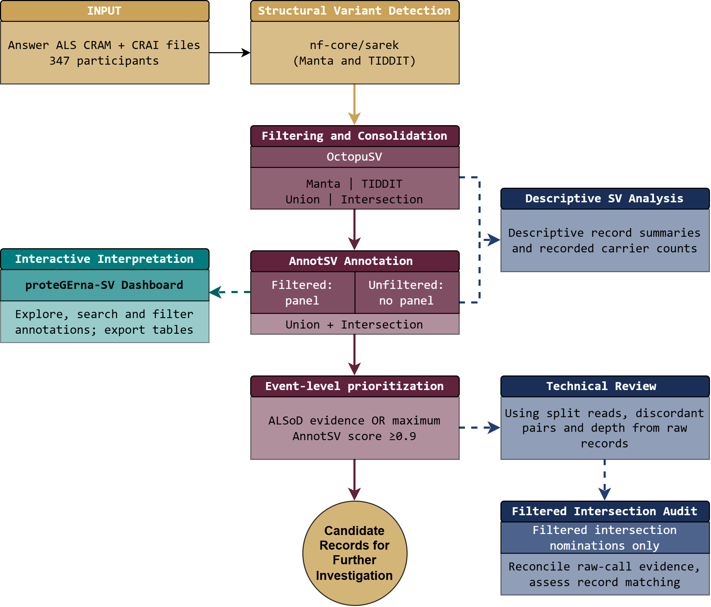

# Structural variant workflow: design logic and methodological considerations

This page explains the **logic** behind how the [Objective 2](Objective-2-Structural-Variants) structural-variant (SV) workflow was built. 
It covers the choices behind calling, consolidation, annotation, nomination and the raw-call audit, what the workflow deliberately leaves out, and how its outputs should (and should not) be read. 
It summarises Chapter 4 of the dissertation (Sections 4.1–4.2 and 4.4). 

For how to run each step, see [Objective 2](Objective-2-Structural-Variants).



**Contents**
- [Structural variant workflow: design logic and methodological considerations](#structural-variant-workflow-design-logic-and-methodological-considerations)
  - [1. What the workflow is for](#1-what-the-workflow-is-for)
  - [2. What it deliberately does not do](#2-what-it-deliberately-does-not-do)
  - [3. Cohort and data linkage](#3-cohort-and-data-linkage)
  - [4. Workflow overview](#4-workflow-overview)
  - [5. Tool selection](#5-tool-selection)
  - [6. Calling with two complementary callers](#6-calling-with-two-complementary-callers)
  - [7. Harmonisation and cohort consolidation](#7-harmonisation-and-cohort-consolidation)
  - [8. Carrier status: what a genotype means here](#8-carrier-status-what-a-genotype-means-here)
  - [9. ALS-informed annotation](#9-als-informed-annotation)
  - [10. Nomination: three questions in order](#10-nomination-three-questions-in-order)
    - [10.1 Two nomination routes, combined with OR](#101-two-nomination-routes-combined-with-or)
    - [10.2 Review tiers (Table 4.2)](#102-review-tiers-table-42)
  - [11. The raw-call audit](#11-the-raw-call-audit)
    - [11.1 Matching a raw call to a nomination](#111-matching-a-raw-call-to-a-nomination)
    - [11.2 Participant-level evidence rule](#112-participant-level-evidence-rule)
    - [11.3 Event-level support and sensitivity](#113-event-level-support-and-sensitivity)
  - [12. Final dispositions and the audited release](#12-final-dispositions-and-the-audited-release)
  - [13. The proteGErna-SV dashboard](#13-the-protegerna-sv-dashboard)
  - [14. How to interpret the outputs](#14-how-to-interpret-the-outputs)
  - [15. Limitations and future work (as reported in my dissertation)](#15-limitations-and-future-work-as-reported-in-my-dissertation)
  - [Key literature](#key-literature)

---

## 1. What the workflow is for

The workflow connects complementary short-read SV calls, cohort consolidation, annotation and **ALS-informed candidate
nomination** in one documented, versioned sequence, ending in an **audited candidate release** for
[Objective 4](Objective-4-Multi-Omics-Integration). It also provides **proteGErna-SV**, an interactive review dashboard
extended from the published RareInsight interface.

**ALS guides candidate selection; it is not the subject of testing.** The chapter evaluates the workflow, not
ALS-specific hypotheses. ALS-specific interpretation is deferred to Objective 4, where candidates can be checked against
matched RNA and protein.

Four evaluation endpoints are kept apart:

| Endpoint | Status |
| --- | --- |
| **Execution success**: ran for all 347 participants, with versioned, checksummed outputs at every stage | Demonstrated |
| **Consolidation fidelity**: merged calls checked against raw caller records | Targeted audit of the 50 filtered intersection nominations and reviewed union-only nominations, not a validation of full callsets |
| **Prioritisation performance** and **interface correctness** | Not tested |
| **Caller accuracy against a truth set** and **recovery of known ALS SVs** | Not tested; outside scope |

So success is defined as **deterministic, documented, ALS-informed nomination with an explicit record of every
decision**. A "primary candidate" is a nomination that met the release rules, **not** a conclusion that the variant is
real, pathogenic or ALS-specific.

## 2. What it deliberately does not do

The scope is set by what short-read callers can resolve reliably and by what the later integration needs:

| Outside scope | Why |
| --- | --- |
| **SVs < 50 bp** | Conventionally indels, not SVs |
| **SVs > 100 kb** | Short-read calls this large rest increasingly on discordant pairs and depth without resolved breakpoints; better handled by dedicated read-depth CNV callers. They also span several genes, which makes gene-level prioritisation less informative. CNVkit ran inside Sarek but its output wasn't used |
| **Breakend (BND) records / balanced translocations** | No single length or end coordinate, so they can't be size-filtered, summarised or matched like intrachromosomal events; resolving them needs paired-breakend reconstruction that wasn't implemented |
| **Inversions in the primary callset** | Manta v1.6.0 reports inversions as paired BNDs, so they're removed with BNDs; union inversions come from TIDDIT alone and can't enter the two-caller intersection (e.g. the ALS-associated VCP inversion class isn't detectable here) |
| **Repeat expansions** (e.g. C9orf72) | Need repeat-aware genotyping. C9orf72/ATXN2 status, where mentioned, comes from Answer ALS ExpansionHunter calls (> 26 repeats = expanded) |
| **Cohort-wide re-genotyping** | Not performed, so a reference genotype means "no recorded call" (see [Section 8](#8-carrier-status-what-a-genotype-means-here)) |
| **Read alignment and duplicate marking** | Starts from CRAMs Answer ALS had already aligned and duplicate-marked, so it is a reproducible *downstream* workflow and inherits any alignment-stage artefacts |

Deletions and duplications in ALS genes are the classes the workflow captures best, which fits the (sparse) evidence
for rare CNV contributions to ALS.

## 3. Cohort and data linkage

- **347 participants** with genomic, transcriptomic and proteomic data, after excluding proteomic samples Answer ALS
  flagged for batch effects (see [Cohort preparation](Cohort-Preparation)). 286 ALS, 51 healthy controls and 10 disease
  controls (7 non-ALS motor neuron disease, 3 asymptomatic carriers).
- **The cohort is selected by data availability, not representative.** Retention differed by group (37.0% of ALS
  genomes, 51.5% of controls, 11.5% of other MND), so results describe this multi-omics subset.
- **"CASE" means the Answer ALS label**, which covers ALS *and* disease controls. CASE-prefixed n = 296, CTRL-prefixed
  n = 51.
- **Layers are linked by participant, not by sample.** WGS DNA came from whole blood, while RNA and protein came from
  iPSC-derived motor neurons, at a different time and cell state. Answer ALS karyotyping and STR profiling guard
  against swaps and gross rearrangements, but not against smaller line-specific copy-number changes. Objective 4
  addresses tissue comparability.
- The recurring control line CTRL-NEUEU392AE8 counts as one healthy-control genome here, and is excluded from
  Objective 4's integration.

## 4. Workflow overview

```text
347 Answer ALS CRAMs (GRCh38_full_analysis_set_plus_decoy_hla)
   │
01 nf-core/sarek 3.5.1 ── Manta 1.6.0 + TIDDIT 3.6.1 per participant (from prepare_recalibration)
   │
02 OctopuSV 0.3.5 ── clean + correct (50–100,000 bp; BND removed)
   │                 ├─ per caller, merged across participants ──────────► Manta cohort, TIDDIT cohort
   │                 └─ per participant: caller-mode ∩ and ∪ → merged across participants ► intersection, union
   │
03 AnnotSV 3.5.8 ── ALSoD 154-gene panel: gene-filtered and unfiltered runs, on intersection and union
   │
04 statistics + event prioritisation ── ALSoD-evidence OR AnnotSV-score route → review tiers 1–4
   │
05 raw-call audit ── re-match nominations to raw Manta/TIDDIT VCFs, evidence rules, 4 matching settings
   │                  → audited release: 24 primary candidates, 55 participant–candidate pairs
06 proteGErna-SV ── interactive review of the annotated VCFs (exploration, not selection)
```

Code: `02_SV_analysis/01_sv_calling` → `06_dashboard`. Key scripts: `01_octopusv_manta_tiddit.sh`,
`02a_run_annotsv_filtered.sh`, `01_summarise_callset_qc.py`, `02c_prioritise_annotsv_events.py`,
`01b_extract_raw_calls.py`, `01c_score_raw_call_evidence.py`, `02a_build_audited_release.py`,
`02b_verify_audited_release.py`, `proteGErna-SV.R`.

## 5. Tool selection

Selection was made **at the level of the workflow**, not tool by tool. The [Objective 1](Objective-1-Biotools-Landscape)
registry screen **recorded** the tools' metadata but **did not decide** the selection (Appendix Table 4A.1):

- **nf-core/sarek** (and Manta, TIDDIT and AnnotSV) passed every Objective 1 eligibility gate.
- **Two callers** were used because benchmarking shows short-read SV callers differ in sensitivity by class, size and
  genomic context.
- **OctopuSV** wasn't in bio.tools at the snapshot. It was chosen from the literature for standardising breakend
  representation and for set operations across callers and participants. The analysis used pre-release v0.3.5.
- **AnnotSV** was chosen for integrated gene, disease and ranking annotation.

*Lesson carried from Objective 1:* registry metadata narrow the options, but benchmarks and method literature are still
needed to choose between them.

## 6. Calling with two complementary callers

| Caller | Evidence used | Strength |
| --- | --- | --- |
| **Manta** | Assembles split-read and read-pair evidence into base-pair-resolution junctions | Precise breakpoints; small events |
| **TIDDIT** | Adds read depth | Larger deletions and duplications |

Because the inputs are CRAMs, the **same reference used to create them** (`GRCh38_full_analysis_set_plus_decoy_hla.fa`)
must be used throughout. Sarek starts from `prepare_recalibration` (BQSR preparation), since mapping and duplicate marking
were already done.

**Caller agreement is computational support, not validation.** Both callers read the same alignments, so errors from
repeats or mapping ambiguity can affect both.

## 7. Harmonisation and cohort consolidation

1. **Identifier checks.** The two caller collections must have matching participant IDs. Duplicates or discordant IDs
   are rejected, and sample names are standardised.
2. **Clean and correct** (OctopuSV). Keeps 50–100,000 bp inclusive and removes BND records.
3. **Caller filter status is *not* used here.** Merged callsets include calls that failed Manta or TIDDIT filters. The
   PASS requirement is applied later, in the raw-call audit, where it matters for the released candidates.
4. **Within each participant**, Manta and TIDDIT are combined in caller mode as an **intersection** (matched by both) and
   a **union** (either).
5. **Across participants**, each is merged in sample mode (union of calls), giving four retained cohort callsets:
   Manta, TIDDIT, intersection and union. They are kept separate to preserve provenance.
6. **Genotype choice.** OctopuSV doesn't genotype. Where both callers called a variant, one genotype is kept by caller
   agreement, then variant-supporting reads, then input order (Manta first).

**The intersection is the primary callset** for descriptive summaries and nomination. The union is a more inclusive
comparison. Because the two are merged separately, the same variant can be described slightly differently in each, so a
union variant without an exact intersection match is **not assumed to be single-caller**.

## 8. Carrier status: what a genotype means here

- Merged sites were **not re-genotyped**, and participants without a call are assigned **0/0**. So **0/0 means "no
  recorded call", not a confirmed reference allele**. A control without a call is not a confirmed non-carrier.
- Two biases pull in opposite directions. Missing calls make recorded carrier counts an **underestimate**, while calls
  that failed caller filters make them an **overestimate**. The raw-call audit checks both for prioritised events.
- **Descriptive summaries** keep biallelic records of known length (50–100,000 bp), count each full record once, and use
  `|SVLEN|` (with fallbacks from END−POS or sequence-resolved alleles). Reported SVLEN is kept even when it disagrees with
  the coordinate span, and such cases are flagged for review.
- **For nomination**, carriers are combined across all annotation rows of an AnnotSV ID, so each participant counts once
  per event. Partial genotypes (e.g. `./1`) count as carriers, but missing and 0/0 don't.
- **Frequencies use fixed denominators**: CASE 296, CTRL 51, all 347, including participants with missing genotypes.
  They are **cohort carrier proportions, not population allele frequencies**. "Case-only" means only in CASE-prefixed
  samples, not only in ALS.
- No genotype-quality or depth threshold is applied at this stage.

## 9. ALS-informed annotation

- **AnnotSV 3.5.8** (GRCh38, Ensembl transcripts) annotates both the intersection and the union, each **twice**: with
  and without candidate-gene filtering.
- **Gene panel:** 154 ALSoD genes (accessed 24 Feb 2026). Evidence categories are kept so that stronger associations
  can be separated from weaker ones:

  | ALSoD category | Genes | Used by the gene route? |
  | --- | --- | --- |
  | Definitive ALS gene | 17 | Yes |
  | Strong evidence | 7 | Yes |
  | Moderate evidence | 21 | Yes |
  | Tenuous | 104 | No (score route only) |
  | Clinical modifier | 3 | No |
  | Unassigned | 2 | No |

- **No HPO terms** were supplied, so the filtered and unfiltered runs differ **only** in candidate-gene filtering.
- AnnotSV writes a full-event row plus split per-gene/transcript rows. AnnotSV IDs link them, so **rows aren't counted as
  separate variants**.
- **Annotations aren't conclusions.** Gene overlap isn't disruption, and an automated class isn't rarity in gnomAD or
  pathogenicity. Missing annotations are reported as *unclassified*, not zero.

## 10. Nomination: three questions in order

AnnotSV output is the **starting point** for nomination, not the result. Each event is asked three questions, in order:

1. **Is it prioritised** by stronger ALS gene evidence or by its AnnotSV ranking score?
2. **How are its recorded carriers distributed** between CASE and CTRL, and is it shared with controls or frequent?
3. **Is it supported by the raw Manta and TIDDIT records**, and does that decision hold under several reasonable matching
   settings? (See [Section 11](#11-the-raw-call-audit).)

### 10.1 Two nomination routes, combined with OR

Events are consolidated by AnnotSV ID (keeping the **maximum** ranking score across full and split rows), and nominated
if **either** applies:

| Route | Rule | What it captures |
| --- | --- | --- |
| **Knowledge-driven** | Overlaps an ALSoD gene graded Definitive, Strong or Moderate | Evidence linking the *gene* to ALS (logic similar to ClinGen gene–disease validity). Tenuous and modifier genes are excluded as a conservative choice |
| **Gene-agnostic** | Maximum AnnotSV ranking score ≥ 0.9 | Evidence about the *variant* itself: the likely pathogenic (0.90–0.98) and pathogenic (≥ 0.99) bands of the ACMG/ClinGen CNV point system |

AnnotSV score classes (Table 4.1): ≥ 0.99 pathogenic (class 5); 0.90–0.98 likely pathogenic (4); 0.89 to −0.89 VUS (3);
−0.90 to −0.98 likely benign (2); ≤ −0.99 benign (1). **AnnotSV scores only deletions and duplications**, so insertions
and inversions are unclassified and can't use the score route. Neither route shows what an SV *does*. Their value is
that selection is explicit and traceable.

The same rules were applied to **union-only** events and to the **unfiltered** runs as supplementary nominations. These
weren't released (Appendix 4A.5).

### 10.2 Review tiers (Table 4.2)

| Tier | Description |
| --- | --- |
| 1 | Case-only event affecting an ALSoD gene with Moderate, Strong or Definitive evidence |
| 2 | Case-only event nominated through its AnnotSV score without stronger ALSoD evidence |
| 3 | Event observed in controls, below the frequency-review thresholds |
| 4 | No non-reference genotype; or control frequency ≥ 5%; or ≥ 3 control carriers; or overall frequency ≥ 10%; or control frequency ≥ case frequency (with ≥ 1 control carrier). **Tier 4 takes precedence** |

- The tiers loosely draw on ACMG benign criteria BS1 (frequency too high) and BS2 (seen in unaffected individuals) but
  **don't apply them**. They're a study-specific way of ordering review.
- **Control carriers aren't evidence of benignity.** ALS is adult-onset and many ALS genes are incompletely penetrant,
  so a control carrier may still develop ALS.
- With 51 controls, "≥ 3 control carriers" and "≥ 5% control frequency" select the same events (3/51 = 5.9%).
- Tiers use CASE/CTRL prefixes only and weren't recomputed by confirmed diagnosis, so they're **provisional** with
  respect to diagnosis.
- **Deterministic ordering:** tier → ALSoD evidence → max AnnotSV score → case-minus-control frequency → carrier count →
  chromosome, start and event ID (to break any remaining ties).

## 11. The raw-call audit

**Why re-check the raw calls?** Merging tools can over-merge or split alleles. Truvari showed that over-merging can
inflate allele frequencies up to 2.2-fold, and Jasmine documented similar inconsistencies. The audit looks for two kinds
of error: **carriers in the merged file with no matching raw call**, and **participants without a merged call who have a
PASS raw call**.

It runs in two stages:
1. **Review stage** (all nominations): broad matching with heuristic labels, used only to compare intersection and
   union-only nominations (Appendix 4A.5).
2. **Audit stage** (the **50 filtered intersection nominations** only): stricter matching, quality and support rules.
   **Only this stage determines the release.**

### 11.1 Matching a raw call to a nomination

| Rule | Value / reason |
| --- | --- |
| Same chromosome and SV type | So an isolated BND can't match an inversion |
| Both breakpoints within **50 bp** | Primary setting |
| Shorter/longer length ratio ≥ **0.70** | Truvari's default size similarity (`pctsize`) |
| Insertions | Matched on start and length only (end isn't informative); insertions without an interpretable length can't match |
| FILTER exactly **PASS** | A missing value (`.`) doesn't count |
| Manta sample filter (FT) missing or PASS; genotype complete with an ALT allele | Otherwise the participant's status is *unknown* |
| Initial extraction | Looser (50% reciprocal overlap or breakpoints within 500 bp), then the rules above are applied |

### 11.2 Participant-level evidence rule

The evidence types are the three short-read signals Samplot shows for visual review. The audit turns that visual review
into explicit rules:

- **Grouped by type, not by caller**, so the same signal from both callers isn't counted twice. Split reads (Manta SR /
  TIDDIT RV) are one type, discordant pairs (Manta PR / TIDDIT DV) a second, and read depth a third. For split reads and
  pairs, the **highest** count among matching records is used, not a sum.
- Split reads or pairs: **≥ 3 alternative reads**.
- **Read depth** (only for DEL/DUP ≥ 1 kb, because depth is noisy for short events): TIDDIT coverage relative to the
  flanks **≤ 0.75 for deletions, ≥ 1.25 for duplications**, close to duphold's 0.7/1.3. All of a participant's matching
  depth ratios must agree, and any disagreement is a depth conflict.
- **A participant meets the rule** with **≥ 2 evidence types**, or, for events **< 500 bp** (below roughly fragment
  length, where pairs and depth carry little information), a **precise PASS Manta junction with ≥ 3 split reads**. The
  two routes are labelled separately.
- A participant fails if depth contradicts the call or one caller reports several conflicting alleles.

### 11.3 Event-level support and sensitivity

- Carrier frequencies and tiers are **recalculated from qualifying raw calls** (including single-caller calls) with fixed
  group sizes (296 / 51).
- An event is **supported** when at least half its qualifying carriers (rounded up) meet the participant rule.
- **Matching sensitivity:** breakpoint tolerance 10, 50 and 100 bp at ratio 0.70, plus 50 bp at ratio 0.50. These were
  chosen pragmatically, not optimised. This tests whether *carrier assignment* depends on the matching rule, not how
  events were selected.
- **Flags:** within **100 bp of an STRchive disease-associated repeat** (short-read callers can report repeat
  misalignment as indels or duplications; this flags calls for repeat-aware review, it doesn't genotype expansions) and
  **low mapping quality** (TIDDIT LQ fraction > 0.3).
- **Independent verification:** a separate script (`02b_verify_audited_release.py`) re-reads the raw records and checks
  counts, PASS and genotype handling, matching limits and final decisions.

> **Transparency note:** the matching tolerances, split-read pooling and release criteria were changed **after** the
> first raw-call review. The review-stage rules are reported (Appendix 4A.5), but only the final audit rules determine
> the release.

## 12. Final dispositions and the audited release

Dispositions are assigned **in a fixed order**:

1. **Coordinate or size conflict** → held.
2. **No qualifying raw call** under the primary setting → *excluded* if every recorded carrier's raw calls failed caller
   filters, otherwise *held*.
3. **Audited tier 3 or 4** → deprioritised as shared or frequent.
4. **Tier 1–2 with any hold reason** → exploratory review only. Hold reasons: an unresolved conflict, within 100 bp of an
   STRchive repeat, a raw allele shared with another candidate, > 1 distinct allele from one caller in a participant, low
   mapping quality, failing event-level support, a tier or support decision that changes between matching settings, or
   reaching tier 1–2 **only because the audit rejected earlier control carriers**. The last is a precaution against
   selecting events simply because their control carriers were removed.
5. **Everything else** → **primary research candidate**: tier 1–2 with a stable support decision and tier across all
   four matching settings.

**Participant-level export** further requires the participant to be a qualifying carrier that meets the support rule
under all four settings, without low mapping quality or a shared raw allele.

Outcome for the 50 filtered intersection nominations: **24 primary candidates**, 5 exploratory-review only, 21
deprioritised as shared or frequent, and **55 participant–candidate pairs** handed to Objective 4. The full audit table
keeps every excluded and held candidate. The audit was the step that most changed the results: **99.2%** of intersection
carrier pairs were supported, compared with **73.7%** for the 153 union-only nominations (for 13 union-only nominations,
every carrier's raw calls had failed a caller filter). This justified restricting the release to the intersection.

## 13. The proteGErna-SV dashboard

proteGErna-SV extends the RareInsight dashboard (Coetzer et al., 2025) from reporting clinical genetic results to
reviewing annotated cohort SV callsets. It has four views: **Overview**, **Structural variants**, **Column
descriptions** and **Resource search**. Built in R 4.6.1/Shiny, it reads (gzipped) VCFs up to 60 MiB.

Design intent and caveats:
- **For exploration, not selection.** The scripts merge annotation rows into events and apply strict genotype, PASS and
  matching-stability rules. The dashboard works on **annotation rows**, so its counts aren't distinct variants or
  carriers, and browsing may give a different record set than the audited release.
- The dashboard treats a missing FILTER (`.`) as passing, **unlike the scripted audit**.
- Gene search is partial and case-insensitive. Records lacking population-frequency values are kept by the max-frequency
  filter, and colour highlighting marks thresholds, not pathogenicity.
- Its contribution is **fit with this workflow**, not superiority over AnnotSV/knotAnnotSV. Usability, export
  completeness and agreement with the audited release weren't evaluated.
- The CASE/CTRL sample prefixes can be changed in the source code for other studies.

## 14. How to interpret the outputs

- **Callset construction decides what can be reviewed.** The filtered intersection contained only deletions and
  duplications (58.9% < 1 kb, vs 82.1% in the union). The excess of deletions reflects how the callers and processing
  work, and the absence of insertions and inversions doesn't mean they're absent from the genomes.
- **The gene panel, not the score threshold, was the main restriction.** ALS-gene filtering removed > 99% of eligible
  records. In the unfiltered intersection, the score route added 97 of 145 candidates (all outside the panel). These were
  re-checked but **not released**, because the release was designed as a focused, ALS-informed set. Objective 4 used the
  full AnnotSV tables for genome-wide linking.
- **Overlap ≠ disruption.** Only ~4% of filtered-intersection carrier calls (294/6,707) had a CDS-overlap annotation.
- **Missing AnnotSV class ≠ benign.** All 181 unclassified union-only events were insertions or inversions, which AnnotSV
  doesn't score.
- **Several events in one gene** may be distinct alleles, alternative representations or complex local variation, not
  enrichment.
- **Carrier patterns order review; they don't show disease relevance.** Deletions in all 347 participants (ERBB4, ITPR2)
  likely reflect the reference genome. With 51 controls, absence from controls is weak evidence.
- **Union-only nominations** widen the classes available (insertions, inversions) but have weaker raw-call support, so
  they're a supplementary review set, not follow-up candidates.
- **The audit shows consistency, not truth.** It used the same callers' output, so released calls are consistent, not
  confirmed real.

## 15. Limitations and future work (as reported in my dissertation)

**Limitations**
- Manta–TIDDIT agreement is computational corroboration from shared alignments. Technical support was judged only from
  caller-recorded reads and coverage, because alignments weren't retained (except for the six duplications re-examined in
  Objective 4).
- Repeat context was checked only at STRchive disease loci with a pragmatic 100 bp window. The 58 bp UNC13A deletion at a
  (TTCCT)n repeat shows that an unflagged event can still be repeat-driven.
- The audit covered the 50 intersection nominations and the reviewed union-only nominations, so it **can't estimate the
  error rate** of the broader tables used in Objective 4.
- Support thresholds, the small-event exception, the score threshold and the tiers are **conventional, uncalibrated**
  rules. The sensitivity analysis varied matching, not these thresholds.
- External population rarity wasn't established.
- Diagnoses weren't reconciled with follow-up records. Two of the 24 primary candidates (DAO, CX3CR1) have no ALS
  carrier, and 5 of the 55 pairs involve non-ALS MND or asymptomatic carriers. CTRL-NEUCV809LL4 later received an ALS
  diagnosis, and CASE-NEUMK513KKZ (a DAO carrier) has a recorded bvFTD diagnosis.
- No truth-set benchmarking and no test of recovering known ALS SVs.

**Future work**
1. Vary the selection rules (read support, event-level support, AnnotSV threshold) and report how nominations change.
2. Supply ALS-related HPO terms to AnnotSV, to assess phenotype-directed annotation separately from gene restriction.
3. Reconcile clinical labels, benchmark against a truth set, and align the dashboard with the audited release (load the
   release tables directly, test genotype filtering and export completeness).

## Key literature

The published work behind this design, and what each work justifies, is listed in
[Literature and method justification](Literature-and-Method-Justification#objective-2-structural-variants).
